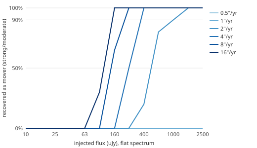

# Sensitivity: injection-recovery test

GENERATED by `python -m app.sensitivity` - do not edit by hand.

## Summary

- `flat` at 2500 uJy, recovered as strong/moderate movers: 0.5"/yr 0/20, 1"/yr 0/20, 2"/yr 20/20, 4"/yr 19/20, 8"/yr 20/20, 16"/yr 20/20.
- `ydwarf` at 2500 uJy, recovered as strong/moderate movers: 0.5"/yr 0/20, 1"/yr 0/20, 2"/yr 0/20, 4"/yr 20/20, 8"/yr 20/20, 16"/yr 20/20.
- `tdwarf` at 2500 uJy, recovered as strong/moderate movers: 0.5"/yr 0/20, 1"/yr 0/20, 2"/yr 3/20, 4"/yr 13/20, 8"/yr 20/20, 16"/yr 20/20.
- Static sources were labelled movers in 0 of 780 trials (none with strong/moderate evidence).

In plain words: on this quiet field, with about a year between the first and last season, the tool reliably flags a moving object as a mover once it moves at least about 2-4"/yr AND is bright enough. Flux at which half of the injected movers are flagged (strong/moderate evidence): `flat` 2"/yr: 538 uJy, 4"/yr: 263 uJy, 8"/yr: 156 uJy, 16"/yr: 123 uJy; `ydwarf` 2"/yr: > 2500 uJy, 4"/yr: 775 uJy, 8"/yr: 250-400 uJy, 16"/yr: 316 uJy; `tdwarf` 2"/yr: > 2500 uJy, 4"/yr: 795 uJy, 8"/yr: 281 uJy, 16"/yr: 225 uJy. Slower than about 2"/yr nothing is flagged at any brightness, because the shift between seasons is then below the pipeline's registration floor. Sources faint in most of the band (Y dwarf-like) must be brighter where they do shine, and a spectrum with deep features inside a wavelength bin (T dwarf-like) is partly lost to the stack outlier rejection (see 'Why bright injections were missed'). These numbers hold for this field's depth and season coverage; a field with more or fewer exposures, crowding or bright stars will differ.

## Method

- Field: quiet COSMOS control field RA 150.11916, Dec 2.20583, 5' (49 x 49 px of 6.15"), cache key `e45062b2648cd21e`; 212 exposures in 3 seasons (2025-05-03, 2025-11-21, 2026-05-10).
- Per trial ONE point source is added to in-memory copies of every exposure's `sci` (MJy/sr; flux converted with `phot.ujy_per_mjysr_pixel`). No noise is added and `var` is unchanged (the real exposures supply the noise; source shot noise is not modelled, which slightly flatters the brightest injections).
- PSF: pixel-integrated circular Gaussian, sigma MEASURED per detector by fitting isolated unsaturated stars (found in the season stacks) in the individual reprojected exposures:

| detector | sigma (px) | IQR | fits (stars) |
|---|---|---|---|
| D1 | 0.624 | 0.562-0.697 | 60 (2) |
| D2 | 0.58 | 0.526-0.649 | 81 (3) |
| D3 | 0.629 | 0.556-0.723 | 37 (1) |
| D4 | 0.68 | 0.62-0.763 | 31 (1) |
| D5 | 0.672 | 0.64-0.741 | 27 (1) |
| D6 | 0.672 | no usable star; value of D5 | - |

- Motion: linear, no parallax, random direction; reference epoch = mean exposure epoch (MJD 61037.4), so the mean injected position is the reference position. Positions are random but at least 6 px (+ the track length) from the edges, 7 px from the field centre (where the target verdict would take over), 4 px from candidates of the un-injected field and off pixels belonging to sources detected in the season stacks or Gaia DR3 stars from the catalogue cache.
- Spectrum shapes (quoted flux = F_nu in the bright parts):
  - `flat`: flat in F_nu: the quoted flux at every wavelength
  - `ydwarf`: Y dwarf-like: the quoted flux in detectors D5 and D6 (about 3.8-5.0 um), zero in D1-D4
  - `tdwarf`: T dwarf-like: the quoted flux at 1.0-1.3 and 4.0-5.0 um, 0.8x at 1.55-1.70 um, 0.5x at 2.05-2.20 um, 0.05x elsewhere
- Variable: static, flat spectrum, flux x1 in seasons 0 and 2 and x2 in season 1 (it doubles between consecutive seasons); quoted flux = the faint state.
- `analysis.run` runs unchanged on the injected arrays (frame loader and stack/diff writer redirected to memory; the fast-mover stage, which does not feed candidates, is skipped). Recovered = a candidate within 1.5 px of the injected mean position (best-ranked if several).
- Trials: 20 per (shape, motion, flux) cell, 40 per variable flux; 5980 trials in total (0 errors); seed 2026; 10 worker processes; runtime 4.6 min.
- Code: git commit `d69a3f6 (+ uncommitted changes in backend/app)`; versions PROCESSING 3, STACK 1, ANALYSIS 6.

## Recovery fractions

Each cell is the fraction of trials recovered; 20 trials per cell (binomial 1-sigma error about 0.11 at 50%).

### `flat`: mover with strong or moderate evidence

| flux (uJy) | 0"/yr | 0.5"/yr | 1"/yr | 2"/yr | 4"/yr | 8"/yr | 16"/yr |
|---|---|---|---|---|---|---|---|
| 10 | 0.00 | 0.00 | 0.00 | 0.00 | 0.00 | 0.00 | 0.00 |
| 16 | 0.00 | 0.00 | 0.00 | 0.00 | 0.00 | 0.00 | 0.00 |
| 25 | 0.00 | 0.00 | 0.00 | 0.00 | 0.00 | 0.00 | 0.00 |
| 40 | 0.00 | 0.00 | 0.00 | 0.00 | 0.00 | 0.00 | 0.00 |
| 63 | 0.00 | 0.00 | 0.00 | 0.00 | 0.00 | 0.00 | 0.00 |
| 100 | 0.00 | 0.00 | 0.00 | 0.00 | 0.00 | 0.00 | 0.20 |
| 160 | 0.00 | 0.00 | 0.00 | 0.00 | 0.00 | 0.60 | 0.95 |
| 250 | 0.00 | 0.00 | 0.00 | 0.00 | 0.50 | 1.00 | 1.00 |
| 400 | 0.00 | 0.00 | 0.00 | 0.15 | 1.00 | 0.95 | 0.90 |
| 630 | 0.00 | 0.00 | 0.00 | 0.80 | 1.00 | 1.00 | 1.00 |
| 1000 | 0.00 | 0.00 | 0.00 | 0.90 | 1.00 | 1.00 | 1.00 |
| 1600 | 0.00 | 0.00 | 0.00 | 1.00 | 0.95 | 1.00 | 1.00 |
| 2500 | 0.00 | 0.00 | 0.00 | 1.00 | 0.95 | 1.00 | 1.00 |

### `flat`: any candidate (any kind or evidence) within 1.5 px

| flux (uJy) | 0"/yr | 0.5"/yr | 1"/yr | 2"/yr | 4"/yr | 8"/yr | 16"/yr |
|---|---|---|---|---|---|---|---|
| 10 | 0.00 | 0.00 | 0.00 | 0.00 | 0.00 | 0.00 | 0.00 |
| 16 | 0.00 | 0.00 | 0.00 | 0.00 | 0.00 | 0.00 | 0.00 |
| 25 | 0.00 | 0.00 | 0.00 | 0.00 | 0.00 | 0.00 | 0.00 |
| 40 | 0.00 | 0.00 | 0.00 | 0.00 | 0.00 | 0.00 | 0.00 |
| 63 | 0.00 | 0.00 | 0.00 | 0.00 | 0.00 | 0.00 | 0.00 |
| 100 | 0.00 | 0.00 | 0.00 | 0.00 | 0.00 | 0.25 | 1.00 |
| 160 | 0.00 | 0.00 | 0.00 | 0.00 | 0.10 | 1.00 | 1.00 |
| 250 | 0.00 | 0.00 | 0.00 | 0.05 | 0.85 | 1.00 | 1.00 |
| 400 | 0.00 | 0.00 | 0.00 | 0.70 | 1.00 | 1.00 | 1.00 |
| 630 | 0.00 | 0.00 | 0.00 | 0.90 | 1.00 | 1.00 | 1.00 |
| 1000 | 0.00 | 0.00 | 0.00 | 1.00 | 1.00 | 1.00 | 1.00 |
| 1600 | 0.00 | 0.00 | 0.05 | 1.00 | 1.00 | 1.00 | 1.00 |
| 2500 | 0.00 | 0.00 | 0.05 | 1.00 | 1.00 | 1.00 | 1.00 |

### `ydwarf`: mover with strong or moderate evidence

| flux (uJy) | 0"/yr | 0.5"/yr | 1"/yr | 2"/yr | 4"/yr | 8"/yr | 16"/yr |
|---|---|---|---|---|---|---|---|
| 10 | 0.00 | 0.00 | 0.00 | 0.00 | 0.00 | 0.00 | 0.00 |
| 16 | 0.00 | 0.00 | 0.00 | 0.00 | 0.00 | 0.00 | 0.00 |
| 25 | 0.00 | 0.00 | 0.00 | 0.00 | 0.00 | 0.00 | 0.00 |
| 40 | 0.00 | 0.00 | 0.00 | 0.00 | 0.00 | 0.00 | 0.00 |
| 63 | 0.00 | 0.00 | 0.00 | 0.00 | 0.00 | 0.00 | 0.00 |
| 100 | 0.00 | 0.00 | 0.00 | 0.00 | 0.00 | 0.00 | 0.00 |
| 160 | 0.00 | 0.00 | 0.00 | 0.00 | 0.00 | 0.00 | 0.00 |
| 250 | 0.00 | 0.00 | 0.00 | 0.00 | 0.00 | 0.00 | 0.05 |
| 400 | 0.00 | 0.00 | 0.00 | 0.00 | 0.00 | 0.60 | 0.95 |
| 630 | 0.00 | 0.00 | 0.00 | 0.00 | 0.20 | 1.00 | 1.00 |
| 1000 | 0.00 | 0.00 | 0.00 | 0.00 | 0.90 | 1.00 | 1.00 |
| 1600 | 0.00 | 0.00 | 0.00 | 0.00 | 0.95 | 1.00 | 1.00 |
| 2500 | 0.00 | 0.00 | 0.00 | 0.00 | 1.00 | 1.00 | 1.00 |

### `ydwarf`: any candidate (any kind or evidence) within 1.5 px

| flux (uJy) | 0"/yr | 0.5"/yr | 1"/yr | 2"/yr | 4"/yr | 8"/yr | 16"/yr |
|---|---|---|---|---|---|---|---|
| 10 | 0.00 | 0.00 | 0.00 | 0.00 | 0.00 | 0.00 | 0.00 |
| 16 | 0.00 | 0.00 | 0.00 | 0.00 | 0.00 | 0.00 | 0.00 |
| 25 | 0.00 | 0.00 | 0.00 | 0.00 | 0.00 | 0.00 | 0.00 |
| 40 | 0.00 | 0.00 | 0.00 | 0.00 | 0.00 | 0.00 | 0.00 |
| 63 | 0.00 | 0.00 | 0.00 | 0.00 | 0.00 | 0.00 | 0.00 |
| 100 | 0.00 | 0.00 | 0.00 | 0.00 | 0.00 | 0.00 | 0.00 |
| 160 | 0.00 | 0.00 | 0.00 | 0.00 | 0.00 | 0.00 | 0.10 |
| 250 | 0.00 | 0.00 | 0.00 | 0.00 | 0.00 | 0.10 | 1.00 |
| 400 | 0.00 | 0.00 | 0.00 | 0.00 | 0.00 | 0.95 | 1.00 |
| 630 | 0.00 | 0.00 | 0.00 | 0.00 | 0.80 | 1.00 | 1.00 |
| 1000 | 0.00 | 0.00 | 0.00 | 0.20 | 1.00 | 1.00 | 1.00 |
| 1600 | 0.00 | 0.00 | 0.00 | 0.55 | 1.00 | 1.00 | 1.00 |
| 2500 | 0.00 | 0.00 | 0.00 | 0.95 | 1.00 | 1.00 | 1.00 |

### `tdwarf`: mover with strong or moderate evidence

| flux (uJy) | 0"/yr | 0.5"/yr | 1"/yr | 2"/yr | 4"/yr | 8"/yr | 16"/yr |
|---|---|---|---|---|---|---|---|
| 10 | 0.00 | 0.00 | 0.00 | 0.00 | 0.00 | 0.00 | 0.00 |
| 16 | 0.00 | 0.00 | 0.00 | 0.00 | 0.00 | 0.00 | 0.00 |
| 25 | 0.00 | 0.00 | 0.00 | 0.00 | 0.00 | 0.00 | 0.00 |
| 40 | 0.00 | 0.00 | 0.00 | 0.00 | 0.00 | 0.00 | 0.00 |
| 63 | 0.00 | 0.00 | 0.00 | 0.00 | 0.00 | 0.00 | 0.00 |
| 100 | 0.00 | 0.00 | 0.00 | 0.00 | 0.00 | 0.00 | 0.00 |
| 160 | 0.00 | 0.00 | 0.00 | 0.00 | 0.00 | 0.00 | 0.00 |
| 250 | 0.00 | 0.00 | 0.00 | 0.00 | 0.00 | 0.30 | 0.80 |
| 400 | 0.00 | 0.00 | 0.00 | 0.00 | 0.05 | 1.00 | 1.00 |
| 630 | 0.00 | 0.00 | 0.00 | 0.00 | 0.60 | 1.00 | 0.95 |
| 1000 | 0.00 | 0.00 | 0.00 | 0.00 | 0.90 | 1.00 | 1.00 |
| 1600 | 0.00 | 0.00 | 0.00 | 0.05 | 0.85 | 0.95 | 1.00 |
| 2500 | 0.00 | 0.00 | 0.00 | 0.15 | 0.65 | 1.00 | 1.00 |

### `tdwarf`: any candidate (any kind or evidence) within 1.5 px

| flux (uJy) | 0"/yr | 0.5"/yr | 1"/yr | 2"/yr | 4"/yr | 8"/yr | 16"/yr |
|---|---|---|---|---|---|---|---|
| 10 | 0.00 | 0.00 | 0.00 | 0.00 | 0.00 | 0.00 | 0.00 |
| 16 | 0.00 | 0.00 | 0.00 | 0.00 | 0.00 | 0.00 | 0.00 |
| 25 | 0.00 | 0.00 | 0.00 | 0.00 | 0.00 | 0.00 | 0.00 |
| 40 | 0.00 | 0.00 | 0.00 | 0.00 | 0.00 | 0.00 | 0.00 |
| 63 | 0.00 | 0.00 | 0.00 | 0.00 | 0.00 | 0.00 | 0.00 |
| 100 | 0.00 | 0.00 | 0.00 | 0.00 | 0.00 | 0.00 | 0.00 |
| 160 | 0.00 | 0.00 | 0.00 | 0.00 | 0.00 | 0.05 | 0.50 |
| 250 | 0.00 | 0.00 | 0.00 | 0.00 | 0.10 | 1.00 | 1.00 |
| 400 | 0.00 | 0.00 | 0.05 | 0.10 | 1.00 | 1.00 | 1.00 |
| 630 | 0.00 | 0.00 | 0.00 | 0.50 | 1.00 | 1.00 | 1.00 |
| 1000 | 0.00 | 0.20 | 0.00 | 0.80 | 1.00 | 1.00 | 1.00 |
| 1600 | 0.15 | 0.15 | 0.10 | 0.90 | 1.00 | 1.00 | 1.00 |
| 2500 | 0.05 | 0.15 | 0.10 | 1.00 | 1.00 | 1.00 | 1.00 |

## Completeness flux

Flux (uJy) at which 50% / 90% of injections are recovered, from a logistic fit in log flux; in brackets the 16-84% range of 200 bootstrap resamples of the trials (binomial). Criterion: mover with strong/moderate evidence for moving sources; any candidate for 0"/yr (a static, constant source should NOT produce a candidate: this column is a false-alarm measure). `> 2500` = not reached within the tested fluxes; `A-B (step)` = recovery jumps from (almost) none to (almost) all between two adjacent tested fluxes, so only that bracket is known.

| motion | flat 50% | flat 90% | ydwarf 50% | ydwarf 90% | tdwarf 50% | tdwarf 90% |
|---|---|---|---|---|---|---|
| 0"/yr | > 2500 | > 2500 | > 2500 | > 2500 | > 2500 | > 2500 |
| 0.5"/yr | > 2500 | > 2500 | > 2500 | > 2500 | > 2500 | > 2500 |
| 1"/yr | > 2500 | > 2500 | > 2500 | > 2500 | > 2500 | > 2500 |
| 2"/yr | 538 (513-566) | 811 (717-912) | > 2500 | > 2500 | > 2500 | > 2500 |
| 4"/yr | 263 (250-276) | 467 (270-541) | 775 (724-833) | 1093 (925-1196) | 795 (713-879) | 2213 (1750-2680) |
| 8"/yr | 156 (152-163) | 217 (170-242) | 250-400 (step) | 400-630 (step) | 281 (257-295) | 419 (275-487) |
| 16"/yr | 123 (118-132) | 195 (165-218) | 316 (271-369) | 377 (288-400) | 225 (220-242) | 305 (256-348) |

## False positives on static sources

- Static, constant injections (0"/yr, all shapes and fluxes) labelled **mover**: 0 of 780 (0.0%, 1-sigma 0.0%-0.1%); with strong/moderate evidence: 0.
- Variable injections labelled mover: 9 of 520 (1.2%-2.4% at 1 sigma).
- Candidates of any kind at static constant injections: {'uncertain': 2, 'variable': 2}.

## Proper-motion accuracy

Movers recovered (any evidence) with a measured proper motion; error = recovered - injected vector; speed bias = median (|recovered| - injected) / injected; all shapes pooled.

| motion | n | median abs error ("/yr) | median speed bias | median direction error (deg) |
|---|---|---|---|---|
| 0.5"/yr | 5 | 6.63 | +1291% | 82 |
| 1"/yr | 2 | 6.93 | +670% | 36 |
| 2"/yr | 175 | 0.22 | +4% | 3 |
| 4"/yr | 279 | 0.31 | +2% | 2 |
| 8"/yr | 356 | 0.34 | +1% | 1 |
| 16"/yr | 388 | 0.50 | +1% | 1 |

## Variable recovery

| faint-state flux (uJy) | variable (strong/moderate) | variable (any) | any candidate | mover |
|---|---|---|---|---|
| 10 | 0.00 | 0.00 | 0.00 | 0.00 |
| 16 | 0.00 | 0.00 | 0.00 | 0.00 |
| 25 | 0.00 | 0.00 | 0.00 | 0.00 |
| 40 | 0.00 | 0.00 | 0.03 | 0.00 |
| 63 | 0.00 | 0.00 | 0.30 | 0.03 |
| 100 | 0.30 | 0.57 | 0.95 | 0.12 |
| 160 | 0.93 | 0.93 | 1.00 | 0.05 |
| 250 | 0.97 | 0.97 | 1.00 | 0.00 |
| 400 | 0.97 | 0.97 | 1.00 | 0.00 |
| 630 | 0.97 | 0.97 | 1.00 | 0.00 |
| 1000 | 0.97 | 0.97 | 1.00 | 0.03 |
| 1600 | 0.97 | 0.97 | 1.00 | 0.00 |
| 2500 | 0.97 | 0.97 | 1.00 | 0.00 |

## Minimum detectable motion

Season mean epochs (MJD): S0 60799, S1 61000, S2 61171; pair baselines S0-S1 0.55 yr, S0-S2 1.02 yr, S1-S2 0.47 yr.
A season pair calls a 'mover' only if the centroid shift is >= 0.15 px and >= 4 sigma, where every centroid error includes a 0.05 px registration floor. Even for an infinitely bright source the shift must therefore exceed 0.28 px (1.74"), i.e. a proper motion of at least 3.2"/yr over S0-S1, 1.7"/yr over S0-S2, 3.7"/yr over S1-S2. 'Strong'/'moderate' evidence further needs two or more independent season comparisons (per detector: seasons in agreeing pairs - 1, summed over detectors), e.g. the S0-S2 pair in two detectors. In this field D3 and D6 have no season-0 exposures (only the 0.47 yr S1-S2 pair), which is why the Y dwarf-like shape (D5/D6 only) needs about twice the motion of a flat one.
- `flat`: slowest tested motion recovered as a strong/moderate mover in >= 50% of trials at the brightest flux (2500 uJy): 2"/yr.
- `tdwarf`: slowest tested motion recovered as a strong/moderate mover in >= 50% of trials at the brightest flux (2500 uJy): 4"/yr.
- `ydwarf`: slowest tested motion recovered as a strong/moderate mover in >= 50% of trials at the brightest flux (2500 uJy): 4"/yr.

## Why bright injections were missed

Injections at 2500 uJy moving >= 4"/yr NOT recovered as strong/moderate movers (8 of 180), by shape:
- `flat`: 1
- `ydwarf`: 0
- `tdwarf`: 7

What the pipeline made of them (kind/evidence: reason):

- 6 x uncertain/weak: change is not centred on a detected source (PSF-edge residual of a nearby star)
- 2 x uncertain/weak: no reason given

Stack outlier rejection, one 8"/yr injection of 2500 uJy per shape at the same place: pixel-frames within 2 px of the source that the per-pixel rejection of `coadd()` removed (season and bin stacks, compared with the un-injected field), and the outcome:

- `flat`: 0 pixel-frames removed; result mover/strong, events ['mover'].
- `ydwarf`: 0 pixel-frames removed; result mover/strong, events ['mover'].
- `tdwarf`: 263 pixel-frames removed (most in s1_d2 34, s1_d1 26, s2_d2 26, s1_d1b0 26); result mover/strong, events ['mover', 'uncertain'].

Interpretation: the exposures in one wavelength bin (and even more in a season x detector stack) sample different wavelengths. For a source whose spectrum changes strongly within a bin, the exposures at its bright wavelengths differ from the per-pixel median by more than 5 sigma + 0.3 |median| and are rejected pixel by pixel, mostly in the PSF core. The remaining pixels form a distorted PSF that differs between seasons, which produces spurious centroid shifts (directions then disagree between pairs, 'centroid shifts disagree') and flux ratios beyond 2, or 'appeared'/'variable' events. A spectrum that is flat within each bin (flat, Y dwarf-like) loses nothing. The T dwarf-like shape used here has sharp 20x steps, harsher than real T dwarfs, but real methane/water bands are deep enough that this should be checked on real T dwarfs before relying on the mover search for them.

Incoherent motion: 26 injections moving >= 2"/yr (by shape {'flat': 9, 'ydwarf': 0, 'tdwarf': 17}; 24 of them at >= 400 uJy) had a candidate whose mover events failed `changes.reconcile_movers` (direction coherence R < 0.8 or speed scatter > 0.5), so EVERY mover event of the candidate was relabelled and it ended 'uncertain'. The check is all-or-nothing: one outlying season pair (a low-S/N pair, or a pair whose centroid is pulled by a faint neighbour) vetoes a candidate even when ten other pairs agree, and because events are weighted by `shift_sigma` (shift / error), a spuriously LARGE shift gets a LARGE weight. Dropping outlying pairs before the coherence test (e.g. iterative clipping on the per-pair proper motion) would recover these; not changed here.

Static (0"/yr) injections whose candidate contained a 'mover' event before vetting (spurious centroid shifts): {'tdwarf': 2}. Vetting or reconciliation demoted these unless counted in the false-positive line above.

## Planet Nine

This was NOT measured; the model injected here (linear motion of 0-16"/yr, no parallax) does not describe such an object. Geometry alone shows why: between two SPHEREx seasons about six months apart the Earth is displaced by up to ~2 AU, so an object at distance d shifts by up to ~2/d radians from parallax:
- d = 300 AU: up to ~1375" (22.9') between seasons, versus a 5' field and the <= 16"/yr linear motions tested here.
- d = 500 AU: up to ~825" (13.8') between seasons, versus a 5' field and the <= 16"/yr linear motions tested here.
- d = 800 AU: up to ~516" (8.6') between seasons, versus a 5' field and the <= 16"/yr linear motions tested here.
Such an object would leave the field or land far from where a linear proper-motion search looks, so this pipeline's season-difference mover search cannot recover it, at any brightness; the flux limits above do not apply. (Distances are the commonly discussed few-hundred-AU range; brightness predictions are model dependent and were not used.)

