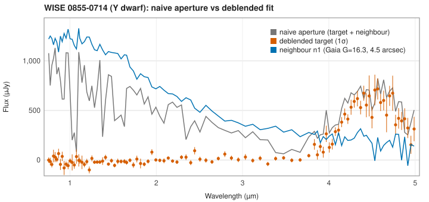
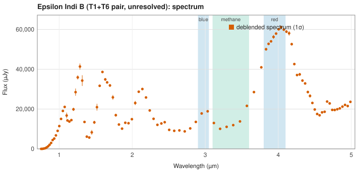

# SPHEREx Time Machine: validation report

Generated 2026-11-14 19:40 UTC · commit `51f75ef` (backend/app has uncommitted changes) · processing v3 · stack v1 · analysis v6 · fingerprint v2 · collections spherex_dr1, spherex_qr3

This file is generated by `python -m app.report` from the cached SPHEREx data; every number is computed, none is typed by hand. Do not edit it; rerun the generator. The targets are known objects used to test the tool, and nothing here is a discovery claim.

## 1. Summary

| Target | Expected | Verdict | Spectral class | Evidence | Measured vs expected | Data used | Seasons | Release (images) |
| :--- | :--- | :--- | :--- | :--- | :--- | :--- | :--- | :--- |
| WISE 0855-0714 (Y dwarf) | mover | mover (as expected) | Y dwarf-like (flux only at 4-5 um) (medium confidence) | strong (3 independent comparison(s) in 2 detector(s)) | 7,753 mas/yr (-7,661, +1,192) vs catalogue 8,152 mas/yr (-8,124, +673): speed -4.9%, direction 4.1 deg | 258 of 258 images (129 exposures) | 3 seasons, 2025-05-05 to 2026-05-14 | spherex_dr1 (258) |
| Barnard's Star | mover | mover (as expected) | not classifiable (too faint, saturated, or blended) (low confidence) | strong (12 independent comparison(s) in 6 detector(s)) | 9,502 mas/yr (-884, +9,461) vs catalogue 10,393 mas/yr (-802, +10,362): speed -8.6%, direction 0.9 deg | 358 of 358 images (181 exposures) | 3 seasons, 2025-08-15 to 2026-09-22 | spherex_dr1 (239), spherex_qr3 (119) |
| Epsilon Indi B (T1+T6 pair, unresolved) | mover | mover (as expected) | T dwarf-like (methane) (high confidence) | strong (14 independent comparison(s) in 6 detector(s)) | 4,373 mas/yr (+3,744, -2,260) vs catalogue 4,684 mas/yr (+3,982, -2,467): speed -6.6%, direction 0.7 deg | 458 of 458 images (238 exposures) | 4 seasons, 2025-04-24 to 2026-10-02 | spherex_dr1 (338), spherex_qr3 (120) |
| RW Aurigae (T Tauri) | variable | variable (as expected) | not classifiable (too faint, saturated, or blended) (low confidence) | strong (6 independent comparison(s) in 3 detector(s)) | flux ratio (later/earlier season) 0.49-0.75 in 8 of 18 pairs; 2.41-5.01 µm (D4, D5, D6); no significant change in D2 0-1, D2 0-2, D2 1-2, D3 0-1, D3 0-2, D3 1-2, D4 0-1 | 335 of 335 images (168 exposures) | 3 seasons, 2025-09-01 to 2026-09-16 | spherex_dr1 (226), spherex_qr3 (109) |
| R Draconis (Mira) | variable | variable (as expected) | not classifiable (too faint, saturated, or blended) (low confidence) | strong (12 independent comparison(s) in 6 detector(s)) | flux ratio (later/earlier season) 0.44-0.78 in 14 of 18 pairs; 0.74-5.01 µm (D1, D2, D3, D4, D5, D6); no significant change in D1 1-2, D4 1-2, D5 1-2 | 539 of 539 images (273 exposures) | 3 seasons, 2025-05-16 to 2026-07-16 | spherex_dr1 (413), spherex_qr3 (126) |
| Control field (COSMOS, quiet sky) | nothing | no detection at the field centre (as expected) | - | weak (0 independent comparison(s) in 0 detector(s)) | no source at the field centre; 2 other candidates (strong 0, moderate 0, weak 2) | 212 of 212 images (107 exposures) | 3 seasons, 2025-04-25 to 2026-05-26 | spherex_dr1 (204), spherex_qr3 (8) |

Flux ratios are later season divided by earlier season. 'Images' are single-detector cutouts of one exposure (the target falls on several detectors per exposure). Evidence levels rank candidates; they are not probabilities (section 5).

**Problems the checks in this report found** (details in section 2 and 3):

- WISE 0855-0714 (Y dwarf): the 'static' rows in D1, D2, D3, D4 measure the neighbouring star, not the target: the deblended fit finds no target flux there. Only the detectors where the target is detected carry motion information.
- Barnard's Star: the speed measured per detector ranges from 9,774 mas/yr (D1) to 12,712 mas/yr (D6), a spread of 28% of the catalogue speed (detectors with two or more pairs). One star has one speed, so this is a systematic of the saturated-core pattern fits; its cause is not determined here and the combined value averages over it.
- Barnard's Star: 9 of 18 single-pair motions differ from the catalogue direction by more than 30 deg; the combined direction is a mean over pairs whose errors partly cancel.
- Barnard's Star: the saturated-core pattern fits have median reduced chi2 23 (range 9-77), so their quoted shift significances are overconfident; the mover verdict rests on shifts far larger than the fit errors, not on the sigma values.
- Epsilon Indi B (T1+T6 pair, unresolved): 1 of 21 single-pair motions differ from the catalogue direction by more than 30 deg; the combined direction is a mean over pairs whose errors partly cancel.
- Epsilon Indi B (T1+T6 pair, unresolved): 3 of 21 mover pairs also change brightness by 5 sigma or more (flux ratios 0.68-0.72). The verdict is 'mover' because the shift test takes precedence; the brightness changes are not interpreted.
- RW Aurigae (T Tauri): in D1 the stack differences say the flux changed by x0.82 (season 2 / season 0) while the PSF light curves say x1.40 (median of 3 bins): opposite directions, so the direction of the change in that detector is unreliable.
- RW Aurigae (T Tauri): light-curve bin d6b3 (4.76-4.86 µm) in season 0 is 0.74 Jy against 5.31 and 4.12 Jy in the adjacent bins: an implausible jump for a smooth spectrum; treat that bin as a failed fit.
- RW Aurigae (T Tauri): light-curve bin d6b3 (4.76-4.86 µm) in season 2 is 0.71 Jy against 1.96 and 1.47 Jy in the adjacent bins: an implausible jump for a smooth spectrum; treat that bin as a failed fit.

## 2. Per-target detail

### WISE 0855-0714 (Y dwarf)

- **Expected:** mover; only visible at 4-5 um; blended with a G=16.3 star 4.4 arcsec away.
- **Field:** centre RA 133.76002, Dec -7.24221 (the position at MJD 61000), 5 arcmin square, 49 x 49 px of 6.15 arcsec; cache key `63adfc52c96d65b9`.
- **Catalogue proper motion used:** (-8,123.7, +673.2) mas/yr = 8,152 mas/yr (RA*cos(Dec), Dec).
- **Result:** mover (as expected); evidence strong. 7,753 mas/yr (-7,661, +1,192) vs catalogue 8,152 mas/yr (-8,124, +673): speed -4.9%, direction 4.1 deg.
- **Data:** spherex_dr1 (258); pipeline l2b-v27 (258).

#### Data coverage (images per season and detector)

| Season | Dates | D1 | D2 | D3 | D4 | D5 | D6 | Total |
| ---: | :--- | ---: | ---: | ---: | ---: | ---: | ---: | ---: |
| 0 | 2025-05-05 to 2025-05-06 | 4 | 8 | 3 | 4 | 8 | 3 | 30 |
| 1 | 2025-10-31 to 2025-12-13 | 18 | 25 | 21 | 18 | 25 | 21 | 128 |
| 2 | 2026-04-21 to 2026-05-14 | 14 | 15 | 21 | 14 | 15 | 21 | 100 |
| all |  | 36 | 48 | 45 | 36 | 48 | 45 | 258 |

#### Measurements at the field centre (one row per detector and season pair)

| Det | Seasons | Kind | Shift (px) | Shift (σ) | Flux ratio | Flux change (σ) | λ compared (µm) | Method | PM of pair (mas/yr) | vs catalogue | Note |
| ---: | :---: | :--- | ---: | ---: | ---: | ---: | :--- | :--- | ---: | ---: | :--- |
| D1 | 0-1 | static | 0.10 | 1.3 | 0.96 | -0.6 | 0.94-1.12 | centroid + aperture; core | - | - |  |
| D1 | 0-2 | static | 0.09 | 1.2 | 1.03 | +0.4 | 0.94-1.12 | centroid + aperture; core | - | - |  |
| D1 | 1-2 | static | 0.04 | 0.5 | 1.01 | +0.2 | 0.74-1.12 | centroid + aperture; core | - | - |  |
| D2 | 0-1 | static | 0.08 | 1.1 | 0.98 | -0.4 | 1.24-1.65 | centroid + aperture; core | - | - |  |
| D2 | 0-2 | static | 0.07 | 0.9 | 0.90 | -1.5 | 1.40-1.65 | centroid + aperture; core | - | - |  |
| D2 | 1-2 | static | 0.05 | 0.7 | 0.96 | -0.6 | 1.10-1.65 | centroid + aperture; core | - | - |  |
| D3 | 0-1 | static | 0.12 | 1.6 | 1.00 | +0.0 | 2.06-2.43 | centroid + aperture; core | - | - |  |
| D3 | 0-2 | static | 0.10 | 1.3 | 0.99 | -0.1 | 2.06-2.43 | centroid + aperture; core | - | - |  |
| D3 | 1-2 | static | 0.03 | 0.4 | 0.99 | -0.2 | 1.64-2.43 | centroid + aperture; core | - | - |  |
| D4 | 0-1 | static | 0.11 | 1.4 | 1.05 | +0.3 | 3.16-3.82 | centroid + aperture; core | - | - |  |
| D4 | 0-2 | static | 0.09 | 1.0 | 0.90 | -0.6 | 3.16-3.82 | centroid + aperture; core | - | - |  |
| D4 | 1-2 | static | 0.04 | 0.5 | 0.90 | -1.4 | 2.41-3.82 | centroid + aperture; core | - | - |  |
| D5 | 0-1 | mover | 0.53 | 6.1 | 0.94 | -0.6 | 3.99-4.42 | centroid + aperture; core | 6,005 | -26%, 0 deg |  |
| D5 | 0-2 | mover | 1.36 | 15.5 | 0.88 | -1.0 | 4.17-4.42 | centroid + aperture; core | 8,291 | +2%, 4 deg |  |
| D5 | 1-2 | mover | 0.51 | 6.3 | 0.90 | -1.0 | 3.82-4.42 | centroid + aperture; core | 6,607 | -19%, 7 deg |  |
| D6 | 0-1 | uncertain | - | - | - | +1.5 | 4.76-5.01 | centroid + aperture; core | - | - | one epoch too shallow to compare |
| D6 | 0-2 | uncertain | - | - | - | +0.8 | 4.76-5.01 | centroid + aperture; core | - | - | one epoch too shallow to compare |
| D6 | 1-2 | mover | 0.65 | 7.9 | 0.89 | -1.2 | 4.42-5.01 | centroid + aperture; core | 9,052 | +11%, 6 deg |  |

Seasons are numbered from 0; flux ratio is later/earlier; 'flux change' is the significance of the flux difference. Pairs marked 'not comparable' have no wavelength bin shared by both seasons.

**Motion coherence.** 4 mover measurements; direction coherence R = 1.00 (1 = identical directions, threshold 0.8); fractional speed scatter 14% (threshold 50%); coherent.
Mean speed per detector: D5 6,968 mas/yr (-15%); D6 9,052 mas/yr (+11%).

#### Evidence checks

| Check | Result | Note |
| :--- | :--- | :--- |
| Seen in two or more detectors | pass |  |
| Two or more independent season comparisons | pass |  |
| Motion agrees in direction and speed across measurements | pass |  |

Level: **strong** (3 independent season comparison(s), 2 detector(s) agreeing with the verdict). A level is a ranking aid, not a probability.

#### Wavelength bins

| Bin | Det | λ range (µm) | Width (µm) | R = λ/Δλ | Channels | Exposures per season | Used by target |
| :--- | :--- | :--- | ---: | ---: | ---: | :--- | :---: |
| d1b0 | D1 | 0.744-0.838 | 0.094 | 8.4 | 5 | S1: 5, S2: 6 | yes |
| d1b1 | D1 | 0.838-0.944 | 0.105 | 8.4 | 5 | S1: 5, S2: 5 | yes |
| d1b2 | D1 | 0.944-1.115 | 0.172 | 6.0 | 7 | S0: 4, S1: 8, S2: 3 | yes |
| d2b0 | D2 | 1.100-1.239 | 0.139 | 8.4 | 5 | S1: 6, S2: 5 | yes |
| d2b1 | D2 | 1.239-1.395 | 0.156 | 8.4 | 5 | S0: 4, S1: 10, S2: 1 | yes |
| d2b2 | D2 | 1.395-1.651 | 0.256 | 6.0 | 7 | S0: 4, S1: 9, S2: 9 | yes |
| d3b0 | D3 | 1.637-1.839 | 0.203 | 8.6 | 5 | S1: 6, S2: 6 | yes |
| d3b1 | D3 | 1.839-2.065 | 0.226 | 8.7 | 5 | S1: 8, S2: 5 | yes |
| d3b2 | D3 | 2.065-2.426 | 0.361 | 6.2 | 7 | S0: 3, S1: 7, S2: 10 | yes |
| d4b0 | D4 | 2.414-2.756 | 0.342 | 7.6 | 5 | S1: 5, S2: 6 | yes |
| d4b1 | D4 | 2.756-3.161 | 0.405 | 7.3 | 5 | S1: 5, S2: 5 | yes |
| d4b2 | D4 | 3.161-3.818 | 0.657 | 5.3 | 7 | S0: 4, S1: 8, S2: 3 | yes |
| d5b0 | D5 | 3.816-3.987 | 0.172 | 22.8 | 5 | S1: 5, S2: 5 | yes |
| d5b1 | D5 | 3.987-4.166 | 0.178 | 22.8 | 5 | S0: 4, S1: 11, S2: 1 | yes |
| d5b2 | D5 | 4.166-4.423 | 0.258 | 16.7 | 7 | S0: 4, S1: 9, S2: 9 | yes |
| d6b0 | D6 | 4.419-4.583 | 0.164 | 27.4 | 5 | S1: 6, S2: 5 | yes |
| d6b1 | D6 | 4.583-4.756 | 0.173 | 27.0 | 5 | S1: 8, S2: 6 | yes |
| d6b2 | D6 | 4.756-5.006 | 0.251 | 19.5 | 7 | S0: 3, S1: 7, S2: 10 | yes |

Comparisons only ever difference stacks of the same bin. Bins start from the 102 channels and merge until every season that can contribute has 3 or more exposures; R is the resolving power of the bin.

#### Limitations that apply

- Saturation in single exposures: 2 of 258 exposures have a saturated core (0 unusable, 13 suspect, 245 good).
- Not comparable: 0 pairs have no wavelength bin with 3 or more exposures in both seasons, and 2 more have one epoch too shallow for the source to be measured. Missing coverage is not evidence of anything.
- Blending: 1 Gaia source(s) come within 10" of the target (closest 4.5", G=16.3); they are fitted simultaneously, so the PSF fluxes are deblended but the aperture fluxes are not.
- Only 3 seasons exist; two or three epochs cannot give a light curve or an orbit.
- A Y dwarf is far too cold to be seen below about 4 um by SPHEREx, so detectors D1-D4 can only see the neighbouring star.

### Barnard's Star

- **Expected:** mover; saturated.
- **Field:** centre RA 269.44629, Dec 4.76788 (the position at MJD 61000), 5 arcmin square, 49 x 49 px of 6.15 arcsec; cache key `948fa6ebeda4f2b8`.
- **Catalogue proper motion used:** (-801.6, +10,362.4) mas/yr = 10,393 mas/yr (RA*cos(Dec), Dec).
- **Result:** mover (as expected); evidence strong. 9,502 mas/yr (-884, +9,461) vs catalogue 10,393 mas/yr (-802, +10,362): speed -8.6%, direction 0.9 deg.
- **Data:** spherex_dr1 (239), spherex_qr3 (119); pipeline l2b-v27 (358).

#### Data coverage (images per season and detector)

| Season | Dates | D1 | D2 | D3 | D4 | D5 | D6 | Total |
| ---: | :--- | ---: | ---: | ---: | ---: | ---: | ---: | ---: |
| 0 | 2025-08-15 to 2025-10-01 | 24 | 18 | 18 | 23 | 18 | 17 | 118 |
| 1 | 2026-03-11 to 2026-05-05 | 18 | 18 | 24 | 18 | 19 | 24 | 121 |
| 2 | 2026-08-16 to 2026-09-22 | 18 | 25 | 17 | 18 | 24 | 17 | 119 |
| all |  | 60 | 61 | 59 | 59 | 61 | 58 | 358 |

#### Measurements at the field centre (one row per detector and season pair)

| Det | Seasons | Kind | Shift (px) | Shift (σ) | Flux ratio | Flux change (σ) | λ compared (µm) | Method | PM of pair (mas/yr) | vs catalogue | Note |
| ---: | :---: | :--- | ---: | ---: | ---: | ---: | :--- | :--- | ---: | ---: | :--- |
| D1 | 0-1 | mover | 0.74 | 9.2 | 1.00 | -0.0 | 0.74-1.12 | shift fit (saturated core); wings 4-6 px (saturated core) | 8,906 | -14%, 36 deg |  |
| D1 | 0-2 | mover | 1.28 | 15.3 | 0.93 | -1.4 | 0.74-1.12 | shift fit (saturated core); wings 4-6 px (saturated core) | 8,126 | -22%, 9 deg |  |
| D1 | 1-2 | mover | 0.92 | 11.3 | 0.93 | -1.5 | 0.74-1.12 | shift fit (saturated core); wings 4-6 px (saturated core) | 12,290 | +18%, 37 deg |  |
| D2 | 0-1 | mover | 0.82 | 8.8 | 0.80 | -4.7 | 1.10-1.65 | shift fit (saturated core); wings 4-6 px (saturated core) | 9,143 | -12%, 56 deg |  |
| D2 | 0-2 | mover | 1.24 | 14.2 | 1.13 | +2.1 | 1.10-1.65 | shift fit (saturated core); wings 4-6 px (saturated core) | 7,716 | -26%, 3 deg |  |
| D2 | 1-2 | mover | 1.17 | 13.2 | 1.32 | +4.5 | 1.10-1.65 | shift fit (saturated core); wings 4-6 px (saturated core) | 16,630 | +60%, 40 deg |  |
| D3 | 0-1 | mover | 0.86 | 9.3 | 1.08 | +1.4 | 1.64-2.43 | shift fit (saturated core); wings 5-7 px (saturated core) | 8,818 | -15%, 24 deg |  |
| D3 | 0-2 | mover | 1.41 | 16.8 | 1.12 | +2.0 | 1.64-2.43 | shift fit (saturated core); wings 4-6 px (saturated core) | 8,744 | -16%, 1 deg |  |
| D3 | 1-2 | mover | 0.79 | 9.3 | 0.97 | -0.5 | 1.64-2.43 | shift fit (saturated core); wings 5-7 px (saturated core) | 12,497 | +20%, 35 deg |  |
| D4 | 0-1 | mover | 0.91 | 11.7 | 0.98 | -0.4 | 2.41-3.82 | shift fit (saturated core); wings 5-7 px (saturated core) | 10,873 | +5%, 28 deg |  |
| D4 | 0-2 | mover | 1.58 | 21.1 | 0.95 | -1.0 | 2.41-3.82 | shift fit (saturated core); wings 5-7 px (saturated core) | 10,036 | -3%, 2 deg |  |
| D4 | 1-2 | mover | 0.88 | 11.6 | 0.95 | -1.0 | 2.41-3.82 | shift fit (saturated core); wings 5-7 px (saturated core) | 11,811 | +14%, 32 deg |  |
| D5 | 0-1 | mover | 1.06 | 13.4 | 0.97 | -0.6 | 3.82-4.42 | shift fit (saturated core); wings 2.5-4.5 px (saturated core) | 11,777 | +13%, 32 deg |  |
| D5 | 0-2 | mover | 1.67 | 22.2 | 0.97 | -0.6 | 3.82-4.42 | shift fit (saturated core); wings 2.5-4.5 px (saturated core) | 10,380 | -0%, 1 deg |  |
| D5 | 1-2 | mover | 0.96 | 12.1 | 0.96 | -0.7 | 3.82-4.42 | shift fit (saturated core); wings 2.5-4.5 px (saturated core) | 13,589 | +31%, 33 deg |  |
| D6 | 0-1 | mover | 0.95 | 10.8 | 0.91 | -1.6 | 4.42-5.01 | shift fit (saturated core); wings 1.5-3.5 px (saturated core) | 9,732 | -6%, 16 deg |  |
| D6 | 0-2 | mover | 1.80 | 24.2 | 0.94 | -1.2 | 4.42-5.01 | shift fit (saturated core); wings 2-4 px (saturated core) | 11,146 | +7%, 3 deg |  |
| D6 | 1-2 | mover | 1.10 | 14.4 | 0.89 | -2.1 | 4.42-5.01 | shift fit (saturated core); wings 2-4 px (saturated core) | 17,257 | +66%, 37 deg |  |

Seasons are numbered from 0; flux ratio is later/earlier; 'flux change' is the significance of the flux difference. Pairs marked 'not comparable' have no wavelength bin shared by both seasons.

**Motion coherence.** 18 mover measurements; direction coherence R = 0.90 (1 = identical directions, threshold 0.8); fractional speed scatter 23% (threshold 50%); coherent.
Mean speed per detector: D1 9,774 mas/yr (-6%); D2 11,163 mas/yr (+7%); D3 10,020 mas/yr (-4%); D4 10,907 mas/yr (+5%); D5 11,916 mas/yr (+15%); D6 12,712 mas/yr (+22%).

#### Evidence checks

| Check | Result | Note |
| :--- | :--- | :--- |
| Seen in two or more detectors | pass |  |
| Two or more independent season comparisons | pass |  |
| Motion agrees in direction and speed across measurements | pass |  |

Level: **strong** (12 independent season comparison(s), 6 detector(s) agreeing with the verdict). A level is a ranking aid, not a probability.

#### Wavelength bins

| Bin | Det | λ range (µm) | Width (µm) | R = λ/Δλ | Channels | Exposures per season | Used by target |
| :--- | :--- | :--- | ---: | ---: | ---: | :--- | :---: |
| d1b0 | D1 | 0.744-0.780 | 0.036 | 20.9 | 2 | S0: 4, S1: 3, S2: 3 | yes |
| d1b1 | D1 | 0.780-0.838 | 0.058 | 14.1 | 3 | S0: 3, S1: 3, S2: 3 | yes |
| d1b2 | D1 | 0.838-0.899 | 0.061 | 14.1 | 3 | S0: 4, S1: 3, S2: 3 | yes |
| d1b3 | D1 | 0.899-0.967 | 0.067 | 13.9 | 3 | S0: 4, S1: 3, S2: 3 | yes |
| d1b4 | D1 | 0.967-1.038 | 0.071 | 14.1 | 3 | S0: 5, S1: 3, S2: 3 | yes |
| d1b5 | D1 | 1.038-1.115 | 0.078 | 13.8 | 3 | S0: 4, S1: 3, S2: 3 | yes |
| d2b0 | D2 | 1.100-1.181 | 0.081 | 14.1 | 3 | S0: 3, S1: 3, S2: 4 | yes |
| d2b1 | D2 | 1.181-1.269 | 0.088 | 13.9 | 3 | S0: 4, S1: 4, S2: 3 | yes |
| d2b2 | D2 | 1.269-1.362 | 0.093 | 14.1 | 3 | S0: 3, S1: 3, S2: 3 | yes |
| d2b3 | D2 | 1.362-1.464 | 0.102 | 13.9 | 3 | S0: 3, S1: 3, S2: 3 | yes |
| d2b4 | D2 | 1.464-1.651 | 0.187 | 8.3 | 5 | S0: 5, S1: 5, S2: 12 | yes |
| d3b0 | D3 | 1.637-1.755 | 0.118 | 14.3 | 3 | S0: 4, S1: 4, S2: 3 | yes |
| d3b1 | D3 | 1.755-1.883 | 0.128 | 14.2 | 3 | S0: 3, S1: 5, S2: 3 | yes |
| d3b2 | D3 | 1.883-2.018 | 0.135 | 14.4 | 3 | S0: 3, S1: 3, S2: 3 | yes |
| d3b3 | D3 | 2.018-2.164 | 0.146 | 14.3 | 3 | S0: 3, S1: 5, S2: 3 | yes |
| d3b4 | D3 | 2.164-2.426 | 0.262 | 8.8 | 5 | S0: 5, S1: 7, S2: 5 | yes |
| d4b0 | D4 | 2.414-2.611 | 0.196 | 12.8 | 3 | S0: 5, S1: 3, S2: 4 | yes |
| d4b1 | D4 | 2.611-2.833 | 0.222 | 12.3 | 3 | S0: 4, S1: 4, S2: 3 | yes |
| d4b2 | D4 | 2.833-3.075 | 0.243 | 12.2 | 3 | S0: 3, S1: 3, S2: 3 | yes |
| d4b3 | D4 | 3.075-3.338 | 0.263 | 12.2 | 3 | S0: 3, S1: 3, S2: 3 | yes |
| d4b4 | D4 | 3.338-3.818 | 0.480 | 7.4 | 5 | S0: 8, S1: 5, S2: 5 | yes |
| d5b0 | D5 | 3.816-3.918 | 0.102 | 37.9 | 3 | S0: 3, S1: 4, S2: 4 | yes |
| d5b1 | D5 | 3.918-4.022 | 0.104 | 38.0 | 3 | S0: 3, S1: 4, S2: 3 | yes |
| d5b2 | D5 | 4.022-4.130 | 0.107 | 37.9 | 3 | S0: 3, S1: 3, S2: 3 | yes |
| d5b3 | D5 | 4.130-4.239 | 0.108 | 38.6 | 3 | S0: 3, S1: 3, S2: 3 | yes |
| d5b4 | D5 | 4.239-4.423 | 0.185 | 23.4 | 5 | S0: 6, S1: 5, S2: 11 | yes |
| d6b0 | D6 | 4.419-4.516 | 0.098 | 45.8 | 3 | S0: 4, S1: 4, S2: 3 | yes |
| d6b1 | D6 | 4.516-4.652 | 0.136 | 33.8 | 4 | S0: 3, S1: 5, S2: 4 | yes |
| d6b2 | D6 | 4.652-4.756 | 0.104 | 45.2 | 3 | S0: 3, S1: 4, S2: 3 | yes |
| d6b3 | D6 | 4.756-4.861 | 0.105 | 45.8 | 3 | S0: 3, S1: 6, S2: 3 | yes |
| d6b4 | D6 | 4.861-5.006 | 0.145 | 33.9 | 4 | S0: 4, S1: 5, S2: 4 | yes |

Comparisons only ever difference stacks of the same bin. Bins start from the 102 channels and merge until every season that can contribute has 3 or more exposures; R is the resolving power of the bin.

#### Limitations that apply

- Saturation: 18 of 18 comparisons use the PSF wings because the core is saturated in the stacks; fluxes from wings are biased and their error bars are underestimated.
- Saturation in single exposures: 358 of 358 exposures have a saturated core (341 unusable, 17 suspect, 0 good).
- Only 3 seasons exist; two or three epochs cannot give a light curve or an orbit.
- A very bright star: the core is saturated in nearly every exposure, so fluxes come from PSF wings only.

### Epsilon Indi B (T1+T6 pair, unresolved)

- **Expected:** mover; methane absorption.
- **Field:** centre RA 331.09642, Dec -56.80058 (the position at MJD 61000), 5 arcmin square, 49 x 49 px of 6.15 arcsec; cache key `ae28459265081b64`.
- **Catalogue proper motion used:** (+3,981.9, -2,466.8) mas/yr = 4,684 mas/yr (RA*cos(Dec), Dec).
- **Result:** mover (as expected); evidence strong. 4,373 mas/yr (+3,744, -2,260) vs catalogue 4,684 mas/yr (+3,982, -2,467): speed -6.6%, direction 0.7 deg.
- **Data:** spherex_dr1 (338), spherex_qr3 (120); pipeline l2b-v27 (458).

#### Data coverage (images per season and detector)

| Season | Dates | D1 | D2 | D3 | D4 | D5 | D6 | Total |
| ---: | :--- | ---: | ---: | ---: | ---: | ---: | ---: | ---: |
| 0 | 2025-04-24 to 2025-06-10 | 3 | 32 | 25 | 4 | 30 | 24 | 118 |
| 1 | 2025-09-28 to 2025-11-12 | 24 | 30 | 23 | 23 | 24 | 22 | 146 |
| 2 | 2026-04-18 to 2026-05-04 | 19 | 7 | 12 | 19 | 6 | 11 | 74 |
| 3 | 2026-09-22 to 2026-10-02 | 0 | 24 | 36 | 0 | 24 | 36 | 120 |
| all |  | 46 | 93 | 96 | 46 | 84 | 93 | 458 |

#### Measurements at the field centre (one row per detector and season pair)

| Det | Seasons | Kind | Shift (px) | Shift (σ) | Flux ratio | Flux change (σ) | λ compared (µm) | Method | PM of pair (mas/yr) | vs catalogue | Note |
| ---: | :---: | :--- | ---: | ---: | ---: | ---: | :--- | :--- | ---: | ---: | :--- |
| D1 | 0-1 | uncertain | - | - | - | - | - | - | - | - | no wavelength bin with 3 or more exposures in both seasons |
| D1 | 0-2 | uncertain | - | - | - | - | - | - | - | - | no wavelength bin with 3 or more exposures in both seasons |
| D1 | 1-2 | mover | 0.50 | 7.0 | 1.15 | +2.7 | 0.74-1.12 | centroid + aperture; core | 5,914 | +26%, 29 deg |  |
| D2 | 0-1 | mover | 0.32 | 4.5 | 0.70 | -7.2 | 1.10-1.65 | centroid + aperture; core | 4,728 | +1%, 28 deg |  |
| D2 | 0-2 | mover | 0.74 | 10.4 | 0.68 | -7.5 | 1.24-1.65 | centroid + aperture; core | 4,735 | +1%, 8 deg |  |
| D2 | 0-3 | mover | 0.91 | 12.9 | 0.72 | -6.5 | 1.10-1.65 | centroid + aperture; core | 4,045 | -14%, 5 deg |  |
| D2 | 1-2 | mover | 0.52 | 7.3 | 1.05 | +1.0 | 1.24-1.65 | centroid + aperture; core | 5,886 | +26%, 34 deg |  |
| D2 | 1-3 | mover | 0.62 | 8.8 | 0.99 | -0.1 | 1.10-1.65 | centroid + aperture; core | 3,926 | -16%, 6 deg |  |
| D2 | 2-3 | static | 0.25 | 3.6 | 0.95 | -1.0 | 1.24-1.65 | centroid + aperture; core | - | - |  |
| D3 | 0-1 | static | 0.22 | 3.1 | 0.96 | -0.8 | 1.64-2.43 | centroid + aperture; core | - | - |  |
| D3 | 0-2 | mover | 0.69 | 9.7 | 1.18 | +3.3 | 1.84-2.43 | centroid + aperture; core | 4,302 | -8%, 3 deg |  |
| D3 | 0-3 | mover | 0.95 | 13.5 | 1.01 | +0.1 | 1.64-2.43 | centroid + aperture; core | 4,222 | -10%, 3 deg |  |
| D3 | 1-2 | mover | 0.45 | 6.3 | 1.14 | +2.6 | 1.84-2.43 | centroid + aperture; core | 4,818 | +3%, 14 deg |  |
| D3 | 1-3 | mover | 0.74 | 10.4 | 1.03 | +0.6 | 1.64-2.43 | centroid + aperture; core | 4,680 | -0%, 2 deg |  |
| D3 | 2-3 | static | 0.27 | 3.8 | 0.82 | -4.0 | 1.84-2.43 | centroid + aperture; core | - | - |  |
| D4 | 0-1 | uncertain | - | - | - | - | - | - | - | - | no wavelength bin with 3 or more exposures in both seasons |
| D4 | 0-2 | uncertain | - | - | - | - | - | - | - | - | no wavelength bin with 3 or more exposures in both seasons |
| D4 | 1-2 | mover | 0.40 | 5.7 | 1.10 | +1.8 | 2.41-3.82 | centroid + aperture; core | 4,734 | +1%, 12 deg |  |
| D5 | 0-1 | static | 0.24 | 3.5 | 1.02 | +0.4 | 3.82-4.42 | centroid + aperture; core | - | - |  |
| D5 | 0-2 | mover | 0.67 | 9.4 | 1.04 | +0.8 | 3.99-4.17 | centroid + aperture; core | 4,274 | -9%, 6 deg |  |
| D5 | 0-3 | mover | 0.97 | 13.7 | 0.92 | -1.6 | 3.82-4.42 | centroid + aperture; core | 4,299 | -8%, 6 deg |  |
| D5 | 1-2 | mover | 0.48 | 6.7 | 1.00 | -0.1 | 3.99-4.17 | centroid + aperture; core | 5,410 | +15%, 16 deg |  |
| D5 | 1-3 | mover | 0.73 | 10.3 | 0.90 | -2.0 | 3.82-4.42 | centroid + aperture; core | 4,635 | -1%, 2 deg |  |
| D5 | 2-3 | mover | 0.32 | 4.5 | 0.90 | -2.0 | 3.99-4.17 | centroid + aperture; core | 4,469 | -5%, 22 deg |  |
| D6 | 0-1 | static | 0.26 | 3.6 | 0.99 | -0.1 | 4.42-5.01 | centroid + aperture; core | - | - |  |
| D6 | 0-2 | mover | 0.68 | 9.6 | 0.91 | -1.8 | 4.76-5.01 | centroid + aperture; core | 4,204 | -10%, 2 deg |  |
| D6 | 0-3 | mover | 0.99 | 14.0 | 0.89 | -2.4 | 4.42-5.01 | centroid + aperture; core | 4,382 | -6%, 5 deg |  |
| D6 | 1-2 | mover | 0.47 | 6.6 | 1.00 | +0.1 | 4.76-5.01 | centroid + aperture; core | 5,016 | +7%, 12 deg |  |
| D6 | 1-3 | mover | 0.74 | 10.5 | 0.90 | -2.1 | 4.42-5.01 | centroid + aperture; core | 4,717 | +1%, 0 deg |  |
| D6 | 2-3 | mover | 0.29 | 4.1 | 0.94 | -1.3 | 4.76-5.01 | centroid + aperture; core | 4,370 | -7%, 17 deg |  |

Seasons are numbered from 0; flux ratio is later/earlier; 'flux change' is the significance of the flux difference. Pairs marked 'not comparable' have no wavelength bin shared by both seasons.

**Motion coherence.** 21 mover measurements; direction coherence R = 0.98 (1 = identical directions, threshold 0.8); fractional speed scatter 11% (threshold 50%); coherent.
Mean speed per detector: D1 5,914 mas/yr (+26%); D2 4,664 mas/yr (-0%); D3 4,506 mas/yr (-4%); D4 4,734 mas/yr (+1%); D5 4,617 mas/yr (-1%); D6 4,538 mas/yr (-3%).

#### Evidence checks

| Check | Result | Note |
| :--- | :--- | :--- |
| Seen in two or more detectors | pass |  |
| Two or more independent season comparisons | pass |  |
| Motion agrees in direction and speed across measurements | pass |  |

Level: **strong** (14 independent season comparison(s), 6 detector(s) agreeing with the verdict). A level is a ranking aid, not a probability.

#### Wavelength bins

| Bin | Det | λ range (µm) | Width (µm) | R = λ/Δλ | Channels | Exposures per season | Used by target |
| :--- | :--- | :--- | ---: | ---: | ---: | :--- | :---: |
| d1b0 | D1 | 0.744-0.838 | 0.094 | 8.4 | 5 | S0: 1, S1: 11, S2: 5 | yes |
| d1b1 | D1 | 0.838-0.944 | 0.105 | 8.4 | 5 | S1: 6, S2: 6 | yes |
| d1b2 | D1 | 0.944-1.115 | 0.172 | 6.0 | 7 | S0: 2, S1: 7, S2: 8 | yes |
| d2b0 | D2 | 1.100-1.239 | 0.139 | 8.4 | 5 | S0: 10, S1: 15, S2: 1, S3: 9 | yes |
| d2b1 | D2 | 1.239-1.395 | 0.156 | 8.4 | 5 | S0: 7, S1: 7, S2: 3, S3: 7 | yes |
| d2b2 | D2 | 1.395-1.651 | 0.256 | 6.0 | 7 | S0: 15, S1: 8, S2: 3, S3: 8 | yes |
| d3b0 | D3 | 1.637-1.839 | 0.203 | 8.6 | 5 | S0: 11, S1: 8, S2: 2, S3: 10 | yes |
| d3b1 | D3 | 1.839-2.065 | 0.226 | 8.7 | 5 | S0: 8, S1: 7, S2: 3, S3: 11 | yes |
| d3b2 | D3 | 2.065-2.215 | 0.149 | 14.3 | 3 | S0: 3, S1: 4, S2: 4, S3: 6 | yes |
| d3b3 | D3 | 2.215-2.426 | 0.211 | 11.0 | 4 | S0: 3, S1: 4, S2: 3, S3: 9 | yes |
| d4b0 | D4 | 2.414-2.756 | 0.342 | 7.6 | 5 | S0: 2, S1: 10, S2: 6 | yes |
| d4b1 | D4 | 2.756-3.161 | 0.405 | 7.3 | 5 | S1: 6, S2: 5 | yes |
| d4b2 | D4 | 3.161-3.818 | 0.657 | 5.3 | 7 | S0: 2, S1: 7, S2: 8 | yes |
| d5b0 | D5 | 3.816-3.987 | 0.172 | 22.8 | 5 | S0: 8, S1: 11, S2: 1, S3: 9 | yes |
| d5b1 | D5 | 3.987-4.166 | 0.178 | 22.8 | 5 | S0: 7, S1: 6, S2: 3, S3: 7 | yes |
| d5b2 | D5 | 4.166-4.423 | 0.258 | 16.7 | 7 | S0: 15, S1: 7, S2: 2, S3: 8 | yes |
| d6b0 | D6 | 4.419-4.583 | 0.164 | 27.4 | 5 | S0: 11, S1: 8, S2: 2, S3: 10 | yes |
| d6b1 | D6 | 4.583-4.756 | 0.173 | 27.0 | 5 | S0: 8, S1: 7, S2: 2, S3: 10 | yes |
| d6b2 | D6 | 4.756-5.006 | 0.251 | 19.5 | 7 | S0: 5, S1: 7, S2: 7, S3: 16 | yes |

Comparisons only ever difference stacks of the same bin. Bins start from the 102 channels and merge until every season that can contribute has 3 or more exposures; R is the resolving power of the bin.

#### Limitations that apply

- Saturation in single exposures: 13 of 458 exposures have a saturated core (0 unusable, 49 suspect, 409 good).
- Not comparable: 4 pairs have no wavelength bin with 3 or more exposures in both seasons, and 0 more have one epoch too shallow for the source to be measured. Missing coverage is not evidence of anything.
- Fewer than 3 exposures (cannot form a wavelength-matched bin): D1 season 3 (0), D4 season 3 (0).
- Only 4 seasons exist; two or three epochs cannot give a light curve or an orbit.
- Two brown dwarfs closer than a SPHEREx pixel: the measurement is of the pair's combined light.

### RW Aurigae (T Tauri)

- **Expected:** variable.
- **Field:** centre RA 76.95653, Dec 30.40144 (the position at MJD 61000), 5 arcmin square, 49 x 49 px of 6.15 arcsec; cache key `07e39f9e69eeb5bb`.
- **Result:** variable (as expected); evidence strong. flux ratio (later/earlier season) 0.49-0.75 in 8 of 18 pairs; 2.41-5.01 µm (D4, D5, D6); no significant change in D2 0-1, D2 0-2, D2 1-2, D3 0-1, D3 0-2, D3 1-2, D4 0-1.
- **Data:** spherex_dr1 (226), spherex_qr3 (109); pipeline l2b-v27 (335).

#### Data coverage (images per season and detector)

| Season | Dates | D1 | D2 | D3 | D4 | D5 | D6 | Total |
| ---: | :--- | ---: | ---: | ---: | ---: | ---: | ---: | ---: |
| 0 | 2025-09-01 to 2025-09-20 | 19 | 18 | 19 | 19 | 18 | 19 | 112 |
| 1 | 2026-02-20 to 2026-03-12 | 19 | 19 | 19 | 19 | 19 | 19 | 114 |
| 2 | 2026-09-02 to 2026-09-16 | 18 | 18 | 18 | 18 | 19 | 18 | 109 |
| all |  | 56 | 55 | 56 | 56 | 56 | 56 | 335 |

#### Measurements at the field centre (one row per detector and season pair)

| Det | Seasons | Kind | Shift (px) | Shift (σ) | Flux ratio | Flux change (σ) | λ compared (µm) | Method | Note |
| ---: | :---: | :--- | ---: | ---: | ---: | ---: | :--- | :--- | :--- |
| D1 | 0-1 | uncertain | 0.73 | 10.3 | 0.80 | -4.4 | 0.74-1.12 | centroid + aperture; core | centroid shifts disagree between detectors/seasons (blend, saturation or PSF change) |
| D1 | 0-2 | uncertain | 0.66 | 9.3 | 0.82 | -3.9 | 0.74-1.12 | centroid + aperture; core | centroid shifts disagree between detectors/seasons (blend, saturation or PSF change) |
| D1 | 1-2 | uncertain | 0.62 | 8.8 | 1.03 | +0.6 | 0.74-1.12 | centroid + aperture; core | centroid shifts disagree between detectors/seasons (blend, saturation or PSF change) |
| D2 | 0-1 | static | 0.02 | 0.3 | 1.32 | +4.0 | 1.10-1.65 | shift fit (saturated core); wings 1-3 px (saturated core) |  |
| D2 | 0-2 | static | 0.02 | 0.3 | 1.26 | +3.9 | 1.10-1.65 | shift fit (saturated core); wings 1-3 px (saturated core) |  |
| D2 | 1-2 | static | 0.03 | 0.5 | 0.89 | -2.0 | 1.10-1.65 | shift fit (saturated core); wings 1-3 px (saturated core) |  |
| D3 | 0-1 | static | 0.05 | 0.6 | 0.99 | -0.2 | 1.64-2.43 | shift fit (saturated core); wings 1-3 px (saturated core) |  |
| D3 | 0-2 | static | 0.00 | 0.1 | 1.03 | +0.7 | 1.64-2.43 | shift fit (saturated core); wings 1.5-3.5 px (saturated core) |  |
| D3 | 1-2 | static | 0.04 | 0.5 | 0.85 | -2.8 | 1.64-2.43 | shift fit (saturated core); wings 1.5-3.5 px (saturated core) |  |
| D4 | 0-1 | static | 0.22 | 3.0 | 0.85 | -3.4 | 2.41-3.82 | shift fit (saturated core); wings 2.5-4.5 px (saturated core) |  |
| D4 | 0-2 | variable | 0.02 | 0.3 | 0.69 | -9.1 | 2.41-3.82 | shift fit (saturated core); wings 2.5-4.5 px (saturated core) |  |
| D4 | 1-2 | variable | 0.15 | 2.1 | 0.75 | -6.3 | 2.41-3.82 | shift fit (saturated core); wings 2.5-4.5 px (saturated core) |  |
| D5 | 0-1 | variable | 0.18 | 2.4 | 0.74 | -5.9 | 3.82-4.42 | shift fit (saturated core); wings 1.5-3.5 px (saturated core) |  |
| D5 | 0-2 | variable | 0.04 | 0.6 | 0.49 | -20.3 | 3.82-4.42 | shift fit (saturated core); wings 1.5-3.5 px (saturated core) |  |
| D5 | 1-2 | variable | 0.21 | 2.8 | 0.57 | -12.4 | 3.82-4.42 | shift fit (saturated core); wings 1.5-3.5 px (saturated core) |  |
| D6 | 0-1 | variable | 0.51 | 6.4 | 0.64 | -9.5 | 4.42-5.01 | shift fit (saturated core); wings 1.5-3.5 px (saturated core) | centroid shifts disagree between detectors/seasons (blend, saturation or PSF change) |
| D6 | 0-2 | variable | 0.02 | 0.3 | 0.49 | -20.6 | 4.42-5.01 | shift fit (saturated core); wings 1.5-3.5 px (saturated core) |  |
| D6 | 1-2 | variable | 0.30 | 3.8 | 0.61 | -9.9 | 4.42-5.01 | shift fit (saturated core); wings 1-3 px (saturated core) |  |

Seasons are numbered from 0; flux ratio is later/earlier; 'flux change' is the significance of the flux difference. Pairs marked 'not comparable' have no wavelength bin shared by both seasons.

**Motion coherence.** 4 mover measurements; direction coherence R = 0.72 (1 = identical directions, threshold 0.8); fractional speed scatter 27% (threshold 50%); NOT coherent.

#### Evidence checks

| Check | Result | Note |
| :--- | :--- | :--- |
| Seen in two or more detectors | pass |  |
| Two or more independent season comparisons | pass |  |

Level: **strong** (6 independent season comparison(s), 3 detector(s) agreeing with the verdict). A level is a ranking aid, not a probability.

#### Wavelength bins

| Bin | Det | λ range (µm) | Width (µm) | R = λ/Δλ | Channels | Exposures per season | Used by target |
| :--- | :--- | :--- | ---: | ---: | ---: | :--- | :---: |
| d1b0 | D1 | 0.744-0.799 | 0.056 | 13.9 | 3 | S0: 3, S1: 4, S2: 3 | yes |
| d1b1 | D1 | 0.799-0.858 | 0.059 | 14.2 | 3 | S0: 3, S1: 3, S2: 3 | yes |
| d1b2 | D1 | 0.858-0.921 | 0.063 | 14.1 | 3 | S0: 3, S1: 3, S2: 3 | yes |
| d1b3 | D1 | 0.921-0.990 | 0.069 | 13.9 | 3 | S0: 4, S1: 4, S2: 4 | yes |
| d1b4 | D1 | 0.990-1.115 | 0.126 | 8.4 | 5 | S0: 6, S1: 5, S2: 5 | yes |
| d2b0 | D2 | 1.100-1.181 | 0.081 | 14.1 | 3 | S0: 3, S1: 4, S2: 3 | yes |
| d2b1 | D2 | 1.181-1.269 | 0.088 | 13.9 | 3 | S0: 3, S1: 3, S2: 3 | yes |
| d2b2 | D2 | 1.269-1.362 | 0.093 | 14.1 | 3 | S0: 3, S1: 4, S2: 3 | yes |
| d2b3 | D2 | 1.362-1.464 | 0.102 | 13.9 | 3 | S0: 4, S1: 3, S2: 4 | yes |
| d2b4 | D2 | 1.464-1.651 | 0.187 | 8.3 | 5 | S0: 5, S1: 5, S2: 5 | yes |
| d3b0 | D3 | 1.637-1.755 | 0.118 | 14.3 | 3 | S0: 4, S1: 4, S2: 3 | yes |
| d3b1 | D3 | 1.755-1.883 | 0.128 | 14.2 | 3 | S0: 3, S1: 3, S2: 3 | yes |
| d3b2 | D3 | 1.883-2.018 | 0.135 | 14.4 | 3 | S0: 3, S1: 3, S2: 3 | yes |
| d3b3 | D3 | 2.018-2.164 | 0.146 | 14.3 | 3 | S0: 4, S1: 3, S2: 4 | yes |
| d3b4 | D3 | 2.164-2.426 | 0.262 | 8.8 | 5 | S0: 5, S1: 6, S2: 5 | yes |
| d4b0 | D4 | 2.414-2.611 | 0.196 | 12.8 | 3 | S0: 3, S1: 4, S2: 3 | yes |
| d4b1 | D4 | 2.611-2.833 | 0.222 | 12.3 | 3 | S0: 3, S1: 3, S2: 3 | yes |
| d4b2 | D4 | 2.833-3.075 | 0.243 | 12.2 | 3 | S0: 3, S1: 3, S2: 3 | yes |
| d4b3 | D4 | 3.075-3.338 | 0.263 | 12.2 | 3 | S0: 4, S1: 3, S2: 4 | yes |
| d4b4 | D4 | 3.338-3.818 | 0.480 | 7.4 | 5 | S0: 6, S1: 6, S2: 5 | yes |
| d5b0 | D5 | 3.816-3.918 | 0.102 | 37.9 | 3 | S0: 3, S1: 4, S2: 4 | yes |
| d5b1 | D5 | 3.918-4.022 | 0.104 | 38.0 | 3 | S0: 3, S1: 3, S2: 3 | yes |
| d5b2 | D5 | 4.022-4.130 | 0.107 | 37.9 | 3 | S0: 3, S1: 3, S2: 3 | yes |
| d5b3 | D5 | 4.130-4.239 | 0.108 | 38.6 | 3 | S0: 4, S1: 3, S2: 3 | yes |
| d5b4 | D5 | 4.239-4.423 | 0.185 | 23.4 | 5 | S0: 5, S1: 6, S2: 6 | yes |
| d6b0 | D6 | 4.419-4.516 | 0.098 | 45.8 | 3 | S0: 4, S1: 3, S2: 3 | yes |
| d6b1 | D6 | 4.516-4.617 | 0.101 | 45.2 | 3 | S0: 3, S1: 3, S2: 3 | yes |
| d6b2 | D6 | 4.617-4.721 | 0.104 | 44.9 | 3 | S0: 3, S1: 4, S2: 3 | yes |
| d6b3 | D6 | 4.721-4.825 | 0.104 | 45.9 | 3 | S0: 4, S1: 3, S2: 3 | yes |
| d6b4 | D6 | 4.825-5.006 | 0.181 | 27.2 | 5 | S0: 5, S1: 6, S2: 6 | yes |

Comparisons only ever difference stacks of the same bin. Bins start from the 102 channels and merge until every season that can contribute has 3 or more exposures; R is the resolving power of the bin.

#### Limitations that apply

- Saturation: 15 of 18 comparisons use the PSF wings because the core is saturated in the stacks; fluxes from wings are biased and their error bars are underestimated.
- Saturation in single exposures: 315 of 335 exposures have a saturated core (71 unusable, 247 suspect, 17 good).
- 4 pairs were relabelled because their centroid shifts disagreed with the other pairs (blend, saturation or PSF change).
- Blending: 1 Gaia source(s) come within 10" of the target (closest 6.1", G=18.8); they are fitted simultaneously, so the PSF fluxes are deblended but the aperture fluxes are not.
- Only 3 seasons exist; two or three epochs cannot give a light curve or an orbit.
- A bright, nebulous young star: saturated in most exposures, with a fainter star 6 arcsec away.

### R Draconis (Mira)

- **Expected:** variable; heavily saturated.
- **Field:** centre RA 248.16761, Dec 66.75498 (the position at MJD 61000), 5 arcmin square, 49 x 49 px of 6.15 arcsec; cache key `637d0d8bc19ea3c5`.
- **Result:** variable (as expected); evidence strong. flux ratio (later/earlier season) 0.44-0.78 in 14 of 18 pairs; 0.74-5.01 µm (D1, D2, D3, D4, D5, D6); no significant change in D1 1-2, D4 1-2, D5 1-2.
- **Data:** spherex_dr1 (413), spherex_qr3 (126); pipeline l2b-v27 (539).

#### Data coverage (images per season and detector)

| Season | Dates | D1 | D2 | D3 | D4 | D5 | D6 | Total |
| ---: | :--- | ---: | ---: | ---: | ---: | ---: | ---: | ---: |
| 0 | 2025-05-16 to 2025-07-22 | 22 | 33 | 23 | 21 | 32 | 22 | 153 |
| 1 | 2025-10-17 to 2026-01-13 | 45 | 37 | 24 | 44 | 38 | 24 | 212 |
| 2 | 2026-04-22 to 2026-07-16 | 24 | 19 | 44 | 23 | 19 | 45 | 174 |
| all |  | 91 | 89 | 91 | 88 | 89 | 91 | 539 |

#### Measurements at the field centre (one row per detector and season pair)

| Det | Seasons | Kind | Shift (px) | Shift (σ) | Flux ratio | Flux change (σ) | λ compared (µm) | Method | Note |
| ---: | :---: | :--- | ---: | ---: | ---: | ---: | :--- | :--- | :--- |
| D1 | 0-1 | variable | 0.22 | 2.4 | 0.59 | -13.1 | 0.74-1.12 | shift fit (saturated core); wings 6-8 px (saturated core) |  |
| D1 | 0-2 | variable | 0.10 | 1.2 | 0.61 | -12.4 | 0.74-1.12 | shift fit (saturated core); wings 6-8 px (saturated core) |  |
| D1 | 1-2 | static | 0.22 | 2.8 | 1.04 | +0.8 | 0.74-1.12 | shift fit (saturated core); wings 6-8 px (saturated core) |  |
| D2 | 0-1 | variable | 0.22 | 2.8 | 0.66 | -10.4 | 1.10-1.65 | shift fit (saturated core); wings 6-8 px (saturated core) |  |
| D2 | 0-2 | variable | 0.21 | 2.8 | 0.49 | -20.6 | 1.10-1.65 | shift fit (saturated core); wings 6-8 px (saturated core) |  |
| D2 | 1-2 | variable | 0.26 | 3.3 | 0.72 | -7.6 | 1.10-1.65 | shift fit (saturated core); wings 6-8 px (saturated core) |  |
| D3 | 0-1 | uncertain | 0.55 | 6.1 | 1.10 | +1.7 | 1.64-2.43 | shift fit (saturated core); wings 7-9 px (saturated core) | centroid shifts disagree between detectors/seasons (blend, saturation or PSF change) |
| D3 | 0-2 | variable | 0.24 | 3.0 | 0.46 | -23.5 | 1.64-2.43 | shift fit (saturated core); wings 7-9 px (saturated core) |  |
| D3 | 1-2 | variable | 0.51 | 6.0 | 0.44 | -24.6 | 1.64-2.43 | shift fit (saturated core); wings 7-9 px (saturated core) | centroid shifts disagree between detectors/seasons (blend, saturation or PSF change) |
| D4 | 0-1 | variable | 0.25 | 3.3 | 0.66 | -10.5 | 2.41-3.82 | shift fit (saturated core); wings 10-12 px (saturated core) |  |
| D4 | 0-2 | variable | 0.01 | 0.1 | 0.60 | -13.4 | 2.41-3.82 | shift fit (saturated core); wings 10-12 px (saturated core) |  |
| D4 | 1-2 | static | 0.22 | 2.8 | 0.91 | -2.1 | 2.41-3.82 | shift fit (saturated core); wings 8-10 px (saturated core) |  |
| D5 | 0-1 | variable | 0.23 | 3.3 | 0.69 | -8.8 | 3.82-4.42 | shift fit (saturated core); wings 7-9 px (saturated core) |  |
| D5 | 0-2 | variable | 0.01 | 0.2 | 0.59 | -13.8 | 3.82-4.42 | shift fit (saturated core); wings 7-9 px (saturated core) |  |
| D5 | 1-2 | static | 0.25 | 3.4 | 0.84 | -3.9 | 3.82-4.42 | shift fit (saturated core); wings 7-9 px (saturated core) |  |
| D6 | 0-1 | variable | 0.19 | 2.5 | 0.78 | -5.7 | 4.42-5.01 | shift fit (saturated core); wings 6-8 px (saturated core) |  |
| D6 | 0-2 | variable | 0.06 | 0.8 | 0.47 | -22.2 | 4.42-5.01 | shift fit (saturated core); wings 6-8 px (saturated core) |  |
| D6 | 1-2 | variable | 0.18 | 2.4 | 0.61 | -12.8 | 4.42-5.01 | shift fit (saturated core); wings 6-8 px (saturated core) |  |

Seasons are numbered from 0; flux ratio is later/earlier; 'flux change' is the significance of the flux difference. Pairs marked 'not comparable' have no wavelength bin shared by both seasons.

**Motion coherence.** 2 mover measurements; direction coherence R = 0.16 (1 = identical directions, threshold 0.8); fractional speed scatter 18% (threshold 50%); NOT coherent.

#### Evidence checks

| Check | Result | Note |
| :--- | :--- | :--- |
| Seen in two or more detectors | pass |  |
| Two or more independent season comparisons | pass |  |

Level: **strong** (12 independent season comparison(s), 6 detector(s) agreeing with the verdict). A level is a ranking aid, not a probability.

#### Wavelength bins

| Bin | Det | λ range (µm) | Width (µm) | R = λ/Δλ | Channels | Exposures per season | Used by target |
| :--- | :--- | :--- | ---: | ---: | ---: | :--- | :---: |
| d1b0 | D1 | 0.744-0.780 | 0.036 | 20.9 | 2 | S0: 3, S1: 6, S2: 3 | yes |
| d1b1 | D1 | 0.780-0.838 | 0.058 | 14.1 | 3 | S0: 3, S1: 11, S2: 3 | yes |
| d1b2 | D1 | 0.838-0.899 | 0.061 | 14.1 | 3 | S0: 3, S1: 8, S2: 3 | yes |
| d1b3 | D1 | 0.899-0.967 | 0.067 | 13.9 | 3 | S0: 5, S1: 8, S2: 6 | yes |
| d1b4 | D1 | 0.967-1.038 | 0.071 | 14.1 | 3 | S0: 3, S1: 6, S2: 3 | yes |
| d1b5 | D1 | 1.038-1.115 | 0.078 | 13.8 | 3 | S0: 5, S1: 6, S2: 6 | yes |
| d2b0 | D2 | 1.100-1.153 | 0.053 | 21.3 | 2 | S0: 4, S1: 4, S2: 3 | yes |
| d2b1 | D2 | 1.153-1.239 | 0.086 | 13.9 | 3 | S0: 6, S1: 6, S2: 3 | yes |
| d2b2 | D2 | 1.239-1.300 | 0.060 | 21.0 | 2 | S0: 5, S1: 4, S2: 3 | yes |
| d2b3 | D2 | 1.300-1.395 | 0.096 | 14.1 | 3 | S0: 7, S1: 6, S2: 3 | yes |
| d2b4 | D2 | 1.395-1.499 | 0.104 | 13.9 | 3 | S0: 6, S1: 8, S2: 3 | yes |
| d2b5 | D2 | 1.499-1.651 | 0.151 | 10.4 | 4 | S0: 5, S1: 9, S2: 4 | yes |
| d3b0 | D3 | 1.637-1.675 | 0.039 | 42.5 | 1 | S0: 3, S1: 3, S2: 4 | yes |
| d3b1 | D3 | 1.675-1.755 | 0.080 | 21.6 | 2 | S0: 4, S1: 4, S2: 5 | yes |
| d3b2 | D3 | 1.755-1.883 | 0.128 | 14.2 | 3 | S0: 6, S1: 3, S2: 8 | yes |
| d3b3 | D3 | 1.883-2.018 | 0.135 | 14.4 | 3 | S0: 3, S1: 5, S2: 11 | yes |
| d3b4 | D3 | 2.018-2.215 | 0.197 | 10.8 | 4 | S0: 3, S1: 5, S2: 9 | yes |
| d3b5 | D3 | 2.215-2.426 | 0.211 | 11.0 | 4 | S0: 4, S1: 4, S2: 7 | yes |
| d4b0 | D4 | 2.414-2.611 | 0.196 | 12.8 | 3 | S0: 3, S1: 9, S2: 3 | yes |
| d4b1 | D4 | 2.611-2.833 | 0.222 | 12.3 | 3 | S0: 3, S1: 9, S2: 3 | yes |
| d4b2 | D4 | 2.833-2.992 | 0.160 | 18.3 | 2 | S0: 3, S1: 5, S2: 3 | yes |
| d4b3 | D4 | 2.992-3.248 | 0.257 | 12.2 | 3 | S0: 4, S1: 9, S2: 6 | yes |
| d4b4 | D4 | 3.248-3.523 | 0.275 | 12.3 | 3 | S0: 3, S1: 6, S2: 3 | yes |
| d4b5 | D4 | 3.523-3.818 | 0.295 | 12.4 | 3 | S0: 5, S1: 6, S2: 5 | yes |
| d5b0 | D5 | 3.816-3.884 | 0.068 | 56.6 | 2 | S0: 3, S1: 4, S2: 3 | yes |
| d5b1 | D5 | 3.884-3.987 | 0.103 | 38.0 | 3 | S0: 6, S1: 6, S2: 3 | yes |
| d5b2 | D5 | 3.987-4.058 | 0.070 | 57.1 | 2 | S0: 5, S1: 4, S2: 3 | yes |
| d5b3 | D5 | 4.058-4.166 | 0.108 | 38.1 | 3 | S0: 7, S1: 6, S2: 3 | yes |
| d5b4 | D5 | 4.166-4.276 | 0.110 | 38.5 | 3 | S0: 6, S1: 8, S2: 3 | yes |
| d5b5 | D5 | 4.276-4.423 | 0.148 | 29.4 | 4 | S0: 5, S1: 9, S2: 4 | yes |
| d6b0 | D6 | 4.419-4.451 | 0.032 | 138.6 | 1 | S0: 3, S1: 3, S2: 4 | yes |
| d6b1 | D6 | 4.451-4.516 | 0.066 | 68.5 | 2 | S0: 4, S1: 4, S2: 5 | yes |
| d6b2 | D6 | 4.516-4.617 | 0.101 | 45.2 | 3 | S0: 6, S1: 3, S2: 8 | yes |
| d6b3 | D6 | 4.617-4.756 | 0.139 | 33.8 | 4 | S0: 3, S1: 6, S2: 14 | yes |
| d6b4 | D6 | 4.756-4.897 | 0.141 | 34.2 | 4 | S0: 3, S1: 5, S2: 9 | yes |
| d6b5 | D6 | 4.897-5.006 | 0.110 | 45.2 | 3 | S0: 3, S1: 3, S2: 5 | yes |

Comparisons only ever difference stacks of the same bin. Bins start from the 102 channels and merge until every season that can contribute has 3 or more exposures; R is the resolving power of the bin.

#### Limitations that apply

- Saturation: 18 of 18 comparisons use the PSF wings because the core is saturated in the stacks; fluxes from wings are biased and their error bars are underestimated.
- Saturation in single exposures: 538 of 539 exposures have a saturated core (539 unusable, 0 suspect, 0 good).
- 2 pairs were relabelled because their centroid shifts disagreed with the other pairs (blend, saturation or PSF change).
- Only 3 seasons exist; two or three epochs cannot give a light curve or an orbit.
- A very bright Mira: saturated in every exposure.

### Control field (COSMOS, quiet sky)

- **Expected:** nothing.
- **Field:** centre RA 150.11916, Dec 2.20583 (the position at MJD 61000), 5 arcmin square, 49 x 49 px of 6.15 arcsec; cache key `e45062b2648cd21e`.
- **Result:** no data (as expected); evidence weak. no source at the field centre; 2 other candidates (strong 0, moderate 0, weak 2).
- **Data:** spherex_dr1 (204), spherex_qr3 (8); pipeline l2b-v27 (212).

#### Data coverage (images per season and detector)

| Season | Dates | D1 | D2 | D3 | D4 | D5 | D6 | Total |
| ---: | :--- | ---: | ---: | ---: | ---: | ---: | ---: | ---: |
| 0 | 2025-04-25 to 2025-05-19 | 8 | 5 | 0 | 8 | 5 | 0 | 26 |
| 1 | 2025-11-17 to 2025-11-26 | 18 | 18 | 18 | 19 | 18 | 18 | 109 |
| 2 | 2026-05-03 to 2026-05-26 | 4 | 16 | 19 | 4 | 16 | 18 | 77 |
| all |  | 30 | 39 | 37 | 31 | 39 | 36 | 212 |

#### Measurements at the field centre (one row per detector and season pair)

| Det | Seasons | Kind | Shift (px) | Shift (σ) | Flux ratio | Flux change (σ) | λ compared (µm) | Method | Note |
| ---: | :---: | :--- | ---: | ---: | ---: | ---: | :--- | :--- | :--- |
| D1 | 0-1 | uncertain | - | - | - | +0.9 | 0.74-1.12 | centroid + aperture; core | one epoch too shallow to compare |
| D1 | 0-2 | uncertain | - | - | - | -0.9 | 0.74-1.12 | centroid + aperture; core | one epoch too shallow to compare |
| D1 | 1-2 | uncertain | - | - | - | -1.6 | 0.74-1.12 | centroid + aperture; core | one epoch too shallow to compare |
| D2 | 0-1 | uncertain | - | - | - | +1.5 | 1.10-1.21 | centroid + aperture; core | one epoch too shallow to compare |
| D2 | 0-2 | uncertain | - | - | - | +0.7 | 1.10-1.21 | centroid + aperture; core | one epoch too shallow to compare |
| D2 | 1-2 | uncertain | - | - | - | +0.2 | 1.10-1.65 | centroid + aperture; core | one epoch too shallow to compare |
| D3 | 1-2 | uncertain | - | - | - | -1.3 | 1.64-2.43 | centroid + aperture; core | one epoch too shallow to compare |
| D4 | 0-1 | uncertain | - | - | - | +0.9 | 2.41-3.82 | centroid + aperture; core | one epoch too shallow to compare |
| D4 | 0-2 | uncertain | - | - | - | -0.1 | 2.41-3.82 | centroid + aperture; core | one epoch too shallow to compare |
| D4 | 1-2 | uncertain | - | - | - | -0.8 | 2.41-3.82 | centroid + aperture; core | one epoch too shallow to compare |
| D5 | 0-1 | uncertain | - | - | - | +0.1 | 3.82-3.95 | centroid + aperture; core | one epoch too shallow to compare |
| D5 | 0-2 | uncertain | - | - | - | +0.3 | 3.82-3.95 | centroid + aperture; core | one epoch too shallow to compare |
| D5 | 1-2 | uncertain | - | - | - | +0.7 | 3.82-4.42 | centroid + aperture; core | one epoch too shallow to compare |
| D6 | 1-2 | uncertain | - | - | - | +0.5 | 4.42-5.01 | centroid + aperture; core | one epoch too shallow to compare |

Seasons are numbered from 0; flux ratio is later/earlier; 'flux change' is the significance of the flux difference. Pairs marked 'not comparable' have no wavelength bin shared by both seasons.

**Motion coherence.** 0 mover measurement(s); too few to check coherence.

#### Evidence checks

| Check | Result | Note |
| :--- | :--- | :--- |
| Seen in two or more detectors | fail |  |
| Two or more independent season comparisons | fail |  |

Level: **weak** (0 independent season comparison(s), 0 detector(s) agreeing with the verdict). A level is a ranking aid, not a probability.

#### Wavelength bins

| Bin | Det | λ range (µm) | Width (µm) | R = λ/Δλ | Channels | Exposures per season | Used by target |
| :--- | :--- | :--- | ---: | ---: | ---: | :--- | :---: |
| d1b0 | D1 | 0.744-1.115 | 0.371 | 2.5 | 17 | S0: 8, S1: 18, S2: 4 | yes |
| d2b0 | D2 | 1.100-1.210 | 0.110 | 10.5 | 4 | S0: 4, S1: 4, S2: 3 | yes |
| d2b1 | D2 | 1.210-1.362 | 0.152 | 8.4 | 5 | S0: 1, S1: 5, S2: 5 | yes |
| d2b2 | D2 | 1.362-1.651 | 0.288 | 5.2 | 8 | S1: 9, S2: 8 | yes |
| d3b0 | D3 | 1.637-1.755 | 0.118 | 14.3 | 3 | S1: 3, S2: 4 | yes |
| d3b1 | D3 | 1.755-1.883 | 0.128 | 14.2 | 3 | S1: 3, S2: 3 | yes |
| d3b2 | D3 | 1.883-2.018 | 0.135 | 14.4 | 3 | S1: 3, S2: 3 | yes |
| d3b3 | D3 | 2.018-2.164 | 0.146 | 14.3 | 3 | S1: 3, S2: 3 | yes |
| d3b4 | D3 | 2.164-2.318 | 0.154 | 14.5 | 3 | S1: 3, S2: 3 | yes |
| d3b5 | D3 | 2.318-2.426 | 0.107 | 22.1 | 2 | S1: 3, S2: 3 | yes |
| d4b0 | D4 | 2.414-3.818 | 1.404 | 2.2 | 17 | S0: 8, S1: 19, S2: 4 | yes |
| d5b0 | D5 | 3.816-3.953 | 0.137 | 28.5 | 4 | S0: 4, S1: 4, S2: 3 | yes |
| d5b1 | D5 | 3.953-4.130 | 0.177 | 22.8 | 5 | S0: 1, S1: 5, S2: 5 | yes |
| d5b2 | D5 | 4.130-4.423 | 0.293 | 14.6 | 8 | S1: 9, S2: 8 | yes |
| d6b0 | D6 | 4.419-4.516 | 0.098 | 45.8 | 3 | S1: 3, S2: 4 | yes |
| d6b1 | D6 | 4.516-4.617 | 0.101 | 45.2 | 3 | S1: 3, S2: 3 | yes |
| d6b2 | D6 | 4.617-4.721 | 0.104 | 44.9 | 3 | S1: 3, S2: 3 | yes |
| d6b3 | D6 | 4.721-4.825 | 0.104 | 45.9 | 3 | S1: 3, S2: 3 | yes |
| d6b4 | D6 | 4.825-5.006 | 0.181 | 27.2 | 5 | S1: 6, S2: 5 | yes |

Comparisons only ever difference stacks of the same bin. Bins start from the 102 channels and merge until every season that can contribute has 3 or more exposures; R is the resolving power of the bin.

#### Limitations that apply

- Not comparable: 0 pairs have no wavelength bin with 3 or more exposures in both seasons, and 14 more have one epoch too shallow for the source to be measured. Missing coverage is not evidence of anything.
- Fewer than 3 exposures (cannot form a wavelength-matched bin): D3 season 0 (0), D6 season 0 (0).
- Only 3 seasons exist; two or three epochs cannot give a light curve or an orbit.
- No known mover or variable at the field centre; used to count false alarms.

## 3. Spectra and light curves

#### WISE 0855-0714 (Y dwarf): naive aperture against deblended fit

| Det | λ range (µm) | Channels | Naive aperture (µJy) | Deblended target (µJy) | Target S/N | Neighbour n1 (G=16.3, 4.5") (µJy) | Neighbour n2 (G=19.1, 29.6") (µJy) |
| :--- | :--- | ---: | ---: | ---: | ---: | ---: | ---: |
| D1 | 0.75-1.10 | 17 | 882 ± 19 | -14.4 ± 9.4 | -1.5 | 1,228 ± 12 | 230 ± 10 |
| D2 | 1.11-1.63 | 17 | 859 ± 15 | -23.7 ± 5.5 | -4.3 | 1,117 ± 9 | 434 ± 11 |
| D3 | 1.66-2.40 | 17 | 576 ± 13 | -3.4 ± 5.2 | -0.6 | 737 ± 8 | 397 ± 9 |
| D4 | 2.44-3.77 | 17 | 217 ± 9 | 9.8 ± 5.4 | 1.8 | 357 ± 7 | 211 ± 10 |
| D5 | 3.83-4.41 | 17 | 451 ± 17 | 298 ± 14 | 21.8 | 227 ± 14 | 196 ± 20 |
| D6 | 4.43-4.99 | 17 | 602 ± 28 | 468 ± 27 | 17.4 | 159 ± 26 | 108 ± 27 |

Each cell is the inverse-variance weighted mean over the channels of one detector, with the formal error of that mean; the spectral shape inside a detector is not removed, so these are band averages, not a spectrum (the spectrum is in the figure). Target S/N below 3 counts as not detected.

- In D1, D2, D3, D4 the deblended fit finds no target flux, yet the naive aperture reports 217 to 882 µJy: that is the neighbour's light (compare the neighbour column).
- Where the target is detected (D5, D6) the naive aperture is 1.29-1.51 times the deblended flux.
- 1 Gaia source(s) come within 10" of the target (closest 4.5", G=16.3); they are fitted simultaneously, so the PSF fluxes are deblended but the aperture fluxes are not.

*Figure: deblended target flux (points, 1σ), naive aperture flux (grey line) and the nearest neighbour (blue line) against wavelength.*

#### Epsilon Indi B (T1+T6 pair, unresolved): methane absorption

| Window | λ (µm) | Channels | Weighted mean flux (µJy) |
| :--- | :--- | ---: | ---: |
| Blue continuum | 2.9-3.05 | 2 | 18,442 ± 263 |
| Methane band | 3.1-3.6 | 6 | 12,180 ± 111 |
| Red continuum | 3.8-4.1 | 8 | 55,892 ± 209 |
| Mean of the two continua |  |  | 37,167 ± 168 |

**Band / continuum = 0.328 ± 0.003** (a flux deficit of 67% in the 3.1-3.6 µm band). The error is statistical only: the two continuum windows lie in different detectors (D4 and D5), so an inter-detector calibration offset of a few percent is not included, and the windows are not corrected for spectral slope.

Same index for other sources fitted in the cached fingerprints (where measurable to 50% or better):

| Source | Band / continuum | Expected |
| :--- | :--- | :--- |
| WISE 0855-0714 (Y dwarf): neighbour n1 (Gaia G=16.3, 4.5" away) | 1.09 ± 0.06 | no methane (ordinary star, not verified spectroscopically) |
| WISE 0855-0714 (Y dwarf): neighbour n2 (Gaia G=19.1, 29.6" away) | 1.02 ± 0.15 | no methane (ordinary star, not verified spectroscopically) |

A smooth stellar spectrum should give a ratio near 1; the offset of a comparison source from 1 shows how much of the index is due to the continuum windows and the detector boundary rather than methane.

*Figure: deblended spectrum with the three windows shaded (blue continuum, methane band, red continuum).*

#### Targets without a usable spectrum

- **Barnard's Star: no usable spectrum.** 358 of 358 exposures have a saturated core (341 unusable, 17 suspect, 0 good); only 0 of 8 measured channels are 'good', the rest come from wings-only fits. Fluxes fitted to unsaturated wings are biased high (the fingerprint notes quote up to about 2x), so no spectrum is shown or interpreted.
- **RW Aurigae (T Tauri): no usable spectrum.** 315 of 335 exposures have a saturated core (71 unusable, 247 suspect, 17 good); only 10 of 86 measured channels are 'good', the rest come from wings-only fits. Fluxes fitted to unsaturated wings are biased high (the fingerprint notes quote up to about 2x), so no spectrum is shown or interpreted.
- **R Draconis (Mira): no usable spectrum.** 538 of 539 exposures have a saturated core (539 unusable, 0 suspect, 0 good); no channel could be measured. Fluxes fitted to unsaturated wings are biased high (the fingerprint notes quote up to about 2x), so no spectrum is shown or interpreted.

#### RW Aurigae (T Tauri): same-wavelength light curve

| Bin | Det | λ (µm) | Season 0 flux (mJy) | Season 1 flux (mJy) | Season 2 flux (mJy) | χ² / dof vs constant | p | Judgement |
| :--- | :--- | :--- | ---: | ---: | ---: | ---: | ---: | :--- |
| d1b0 | D1 | 0.74-0.80 | 76.0 ± 0.6 (n=2) | 117 ± 2 (n=3) | 173 ± 3 (n=2) | 654.4 / 2 | 8.1e-143 | variable |
| d1b1 | D1 | 0.80-0.86 | 97.7 ± 7.5 (n=3) | - | - | - | - | inconclusive (no channel observed in two or more seasons) |
| d1b2 | D1 | 0.86-0.92 | 145 ± 2 (n=1) | 154 ± 3 (n=1) | - | 2.6 / 1 | 1.1e-01 | inconclusive (a season has a single exposure) |
| d1b3 | D1 | 0.92-0.99 | 165 ± 2 (n=4) | 185 ± 2 (n=4) | 230 ± 3 (n=4) | 2.8 / 2 | 2.4e-01 | inconclusive (saturated-core fits; the 15% floor hides smaller changes) |
| d1b4 | D1 | 0.99-1.12 | 170 ± 1 (n=6) | 195 ± 2 (n=5) | 239 ± 2 (n=5) | 2.8 / 2 | 2.5e-01 | inconclusive (saturated-core fits; the 15% floor hides smaller changes) |
| d2b0 | D2 | 1.10-1.18 | 182 ± 2 (n=3) | 224 ± 4 (n=4) | 248 ± 4 (n=3) | 2.4 / 2 | 3.0e-01 | inconclusive (saturated-core fits; the 15% floor hides smaller changes) |
| d2b1 | D2 | 1.18-1.27 | 203 ± 2 (n=3) | 245 ± 3 (n=3) | 272 ± 7 (n=3) | 2.1 / 2 | 3.6e-01 | inconclusive (saturated-core fits; the 15% floor hides smaller changes) |
| d2b2 | D2 | 1.27-1.36 | 222 ± 4 (n=3) | 292 ± 4 (n=4) | 271 ± 5 (n=3) | 1.6 / 2 | 4.4e-01 | inconclusive (saturated-core fits; the 15% floor hides smaller changes) |
| d2b3 | D2 | 1.36-1.46 | 268 ± 5 (n=4) | 369 ± 7 (n=3) | 319 ± 5 (n=3) | 2.3 / 2 | 3.2e-01 | inconclusive (saturated-core fits; the 15% floor hides smaller changes) |
| d2b4 | D2 | 1.46-1.65 | 298 ± 4 (n=5) | 374 ± 6 (n=5) | 311 ± 5 (n=5) | 1.4 / 2 | 5.0e-01 | inconclusive (saturated-core fits; the 15% floor hides smaller changes) |
| d3b0 | D3 | 1.64-1.75 | 324 ± 4 (n=4) | 435 ± 7 (n=4) | 393 ± 8 (n=3) | 2.0 / 2 | 3.7e-01 | inconclusive (saturated-core fits; the 15% floor hides smaller changes) |
| d3b1 | D3 | 1.75-1.97 | 412 ± 5 (n=5) | 392 ± 6 (n=3) | 388 ± 6 (n=4) | 0.1 / 2 | 9.6e-01 | inconclusive (saturated-core fits; the 15% floor hides smaller changes) |
| d3b2 | D3 | 1.97-2.16 | 516 ± 9 (n=4) | 555 ± 18 (n=3) | 450 ± 13 (n=4) | 0.9 / 2 | 6.2e-01 | inconclusive (saturated-core fits; the 15% floor hides smaller changes) |
| d3b3 | D3 | 2.16-2.43 | 529 ± 11 (n=2) | 719 ± 47 (n=3) | 510 ± 9 (n=3) | 3.4 / 2 | 1.8e-01 | inconclusive (saturated-core fits; the 15% floor hides smaller changes) |
| d4b0 | D4 | 2.41-2.48 | 971 ± 78 (n=1) | 939 ± 11 (n=1) | 2,198 ± 209 (n=1) | 20.4 / 2 | 3.7e-05 | inconclusive (a season has a single exposure) |
| d4b1 | D4 | 2.48-2.54 | 1,876 ± 168 (n=1) | - | - | - | - | inconclusive (no channel observed in two or more seasons) |
| d5b0 | D5 | 3.82-3.95 | 3,062 ± 125 (n=3) | 2,025 ± 55 (n=5) | 1,180 ± 9 (n=5) | 39.1 / 2 | 3.3e-09 | variable (indicative) (saturated-core fits, 15% floor exceeded) |
| d5b1 | D5 | 3.95-4.06 | 3,318 ± 115 (n=3) | 2,028 ± 45 (n=3) | 1,275 ± 11 (n=3) | 39.2 / 2 | 3.1e-09 | variable (indicative) (saturated-core fits, 15% floor exceeded) |
| d5b2 | D5 | 4.06-4.24 | 3,744 ± 97 (n=4) | 2,651 ± 45 (n=5) | 1,492 ± 11 (n=5) | 34.9 / 2 | 2.6e-08 | variable (indicative) (saturated-core fits, 15% floor exceeded) |
| d5b3 | D5 | 4.24-4.42 | 3,435 ± 93 (n=5) | 2,588 ± 43 (n=6) | 1,432 ± 11 (n=6) | 29.9 / 2 | 3.2e-07 | variable (indicative) (saturated-core fits, 15% floor exceeded) |
| d6b0 | D6 | 4.42-4.52 | 3,789 ± 74 (n=4) | 2,425 ± 42 (n=3) | 1,293 ± 14 (n=3) | 45.7 / 2 | 1.2e-10 | variable (indicative) (saturated-core fits, 15% floor exceeded) |
| d6b1 | D6 | 4.52-4.65 | 4,077 ± 125 (n=3) | 3,205 ± 57 (n=5) | 1,881 ± 13 (n=4) | 22.1 / 2 | 1.6e-05 | variable (indicative) (saturated-core fits, 15% floor exceeded) |
| d6b2 | D6 | 4.65-4.76 | 5,308 ± 143 (n=3) | 2,467 ± 45 (n=3) | 1,957 ± 17 (n=3) | 53.5 / 2 | 2.4e-12 | variable (indicative) (saturated-core fits, 15% floor exceeded) |
| d6b3 | D6 | 4.76-4.86 | 743 ± 12 (n=3) | 2,058 ± 48 (n=3) | 706 ± 19 (n=4) | 56.2 / 2 | 6.3e-13 | variable (indicative) (saturated-core fits, 15% floor exceeded) |
| d6b4 | D6 | 4.86-5.01 | 4,122 ± 101 (n=4) | 2,462 ± 40 (n=5) | 1,472 ± 10 (n=4) | 49.2 / 2 | 2.1e-11 | variable (indicative) (saturated-core fits, 15% floor exceeded) |

Bins: 15 inconclusive, 1 variable, 9 variable (indicative). Fluxes of one bin are compared only at channels observed in two or more seasons (no spectral slope can mimic variability). The χ² test includes a 2% systematic floor (15% for saturated-core fits) and calls a bin variable at p below 0.001. Absolute fluxes of saturated stars are biased high and should not be quoted as photometry; only the season-to-season pattern within a bin is informative.

**Cross-check between the two independent brightness measurements** (last season over first season):

| Det | Seasons | Stack difference ratio | PSF light-curve ratio (median of bins) | Bins | Directions |
| :--- | :---: | ---: | ---: | ---: | :--- |
| D1 | 2/0 | 0.82 | 1.40 | 3 | DISAGREE |
| D2 | 2/0 | 1.26 | 1.22 | 5 | agree |
| D3 | 2/0 | 1.03 | 0.95 | 4 | agree |
| D4 | 2/0 | 0.69 | 2.26 | 1 | too few bins |
| D5 | 2/0 | 0.49 | 0.39 | 4 | agree |
| D6 | 2/0 | 0.49 | 0.37 | 5 | agree |

#### R Draconis (Mira): same-wavelength light curve

No light curve could be built: all 539 exposures are unusable for PSF photometry (saturated core). The brightness evidence is the season-difference measurement alone (section 2), which is **inconclusive on the amount and the wavelength dependence** of the change because it also relies on saturated wings.

## 4. Other candidates and false alarms

Every candidate found in the six fields other than the target itself (the target is the source at the field centre). Each is matched to the nearest Gaia DR3 source within 6 arcsec, with Gaia positions moved to MJD 61000 by their catalogue proper motion. Candidates labelled `uncertain` were demoted by the pipeline (residuals of a bright or saturated source).

Classes: (1) consistent with a known high-proper-motion star = the measured motion agrees with the Gaia motion within 45 deg and a factor 2 in speed; (2) known Gaia variable = Gaia phot_variable_flag is VARIABLE; (3) matches a non-moving, non-variable Gaia star (likely artefact or uncatalogued variability); (4) matches a Gaia star whose catalogue motion disagrees with the measured motion (Gaia motion at least 100 mas/yr); (5) no Gaia match.

| Field | Cand. | Kind / evidence | Peak σ | RA, Dec (deg) | Measured PM (mas/yr) | Nearest Gaia DR3 (separation) | Gaia PM (mas/yr) | G, variability flag | Classification |
| :--- | :--- | :--- | ---: | :--- | ---: | :--- | ---: | :--- | :--- |
| Barnard's Star | c1 | uncertain / weak (inside the halo of a saturated star) | 36.0 | 269.44551, +4.77582 | - | 4472835979223270016 (4.8") | 3 | 20.5, not flagged | matches a non-moving, non-variable Gaia star (likely artefact or uncatalogued variability) |
| Barnard's Star | c2 | uncertain / weak (inside the halo of a saturated star) | 6.8 | 269.43738, +4.77095 | - | - | - | - | no Gaia match |
| Barnard's Star | c3 | uncertain / weak (inside the halo of a saturated star) | 6.6 | 269.45458, +4.76732 | - | 4472835979222143232 (5.3") | 3 | 20.2, not flagged | matches a non-moving, non-variable Gaia star (likely artefact or uncatalogued variability) |
| Barnard's Star | c4 | uncertain / weak (not significant above the residuals around it (bright-star wings, spikes or crowding)) | 5.0 | 269.46258, +4.76446 | - | - | - | - | no Gaia match |
| Barnard's Star | c5 | uncertain / weak (not significant above the residuals around it (bright-star wings, spikes or crowding)) | 6.1 | 269.43258, +4.77471 | - | - | - | - | no Gaia match |
| Barnard's Star | c6 | uncertain / weak (inside the halo of a saturated star) | 5.3 | 269.45143, +4.77471 | - | 4472835983521061248 (3.5") | 6 | 15.0, not flagged | matches a non-moving, non-variable Gaia star (likely artefact or uncatalogued variability) |
| Barnard's Star | c7 | uncertain / weak (not significant above the residuals around it (bright-star wings, spikes or crowding)) | 4.7 | 269.42572, +4.77642 | - | 4472835949158547712 (4.6") | - | 21.0, not flagged | matches a non-moving, non-variable Gaia star (likely artefact or uncatalogued variability) |
| Barnard's Star | c8 | uncertain / weak (inside the halo of a saturated star) | 4.5 | 269.43943, +4.76276 | - | 4472835876150353408 (2.5") | 10 | 20.7, not flagged | matches a non-moving, non-variable Gaia star (likely artefact or uncatalogued variability) |
| Epsilon Indi B | c1 | uncertain / weak (not significant above the residuals around it (bright-star wings, spikes or crowding)) | 10.6 | 331.07419, -56.76662 | - | - | - | - | no Gaia match |
| Epsilon Indi B | c2 | uncertain / weak (not significant above the residuals around it (bright-star wings, spikes or crowding)) | 9.7 | 331.10974, -56.80384 | - | - | - | - | no Gaia match |
| Epsilon Indi B | c3 | uncertain / weak (not significant above the residuals around it (bright-star wings, spikes or crowding)) | 6.2 | 331.09174, -56.81083 | - | - | - | - | no Gaia match |
| Epsilon Indi B | c4 | uncertain / weak (not significant above the residuals around it (bright-star wings, spikes or crowding)) | 6.0 | 331.04960, -56.81766 | - | - | - | - | no Gaia match |
| RW Aurigae | c1 | uncertain / weak (residual of the target's PSF) | 26.6 | 76.96198, +30.40080 | - | - | - | - | no Gaia match |
| RW Aurigae | c2 | uncertain / weak (change is not centred on a detected source (PSF-edge residual of a nearby star)) | 13.5 | 76.97489, +30.37580 | - | - | - | - | no Gaia match |
| RW Aurigae | c3 | uncertain / weak (not significant above the residuals around it (bright-star wings, spikes or crowding)) | 6.0 | 76.94795, +30.40941 | - | - | - | - | no Gaia match |
| RW Aurigae | c4 | uncertain / weak (residual of the target's PSF) | 22.2 | 76.96089, +30.40527 | - | - | - | - | no Gaia match |
| RW Aurigae | c5 | uncertain / weak (not significant above the residuals around it (bright-star wings, spikes or crowding)) | 8.1 | 76.99119, +30.38435 | - | 156429825683899520 (5.1") | 1 | 17.1, not flagged | matches a non-moving, non-variable Gaia star (likely artefact or uncatalogued variability) |
| RW Aurigae | c6 | uncertain / weak (not significant above the residuals around it (bright-star wings, spikes or crowding)) | 5.7 | 76.95554, +30.38777 | - | - | - | - | no Gaia match |
| RW Aurigae | c7 | uncertain / weak (change is not centred on a detected source (PSF-edge residual of a nearby star)) | 9.8 | 76.98128, +30.37574 | - | - | - | - | no Gaia match |
| RW Aurigae | c8 | uncertain / weak (not significant above the residuals around it (bright-star wings, spikes or crowding)) | 6.2 | 76.97138, +30.39888 | - | - | - | - | no Gaia match |
| RW Aurigae | c9 | uncertain / weak (not significant above the residuals around it (bright-star wings, spikes or crowding)) | 5.9 | 76.94069, +30.39461 | - | - | - | - | no Gaia match |
| RW Aurigae | c10 | uncertain / weak (not significant above the residuals around it (bright-star wings, spikes or crowding)) | 4.9 | 76.96445, +30.38948 | - | - | - | - | no Gaia match |
| Control field | c0 | variable / weak | 6.9 | 150.14993, +2.16995 | - | 3836258500955088256 (1.1") | 51 | 16.9, not flagged | matches a non-moving, non-variable Gaia star (likely artefact or uncatalogued variability) |
| Control field | c1 | uncertain / weak (change is not centred on a detected source (PSF-edge residual of a nearby star)) | 5.3 | 150.08668, +2.24171 | - | - | - | - | no Gaia match |

#### False-alarm counts (non-target candidates per 5 x 5 arcmin field)

| Field | Strong | Moderate | Weak | All | Labelled mover or variable |
| :--- | ---: | ---: | ---: | ---: | ---: |
| WISE 0855-0714 | 0 | 0 | 0 | 0 | 0 |
| Barnard's Star | 0 | 0 | 8 | 8 | 0 |
| Epsilon Indi B | 0 | 0 | 4 | 4 | 0 |
| RW Aurigae | 0 | 0 | 10 | 10 | 0 |
| R Draconis | 0 | 0 | 0 | 0 | 0 |
| Control field | 0 | 0 | 2 | 2 | 1 |
| **all fields** | 0 | 0 | 24 | 24 | 1 |

#### Gaia classification counts

| Field | High-PM star | Gaia variable | Static Gaia star | PM mismatch | No Gaia match |
| :--- | ---: | ---: | ---: | ---: | ---: |
| WISE 0855-0714 | 0 | 0 | 0 | 0 | 0 |
| Barnard's Star | 0 | 0 | 5 | 0 | 3 |
| Epsilon Indi B | 0 | 0 | 0 | 0 | 4 |
| RW Aurigae | 0 | 0 | 1 | 0 | 9 |
| R Draconis | 0 | 0 | 0 | 0 | 0 |
| Control field | 0 | 0 | 1 | 0 | 1 |
| **all fields** | 0 | 0 | 7 | 0 | 17 |

Of 0 non-target candidates with moderate or strong evidence, 0 are explained by a known high-proper-motion star or a Gaia variable and 0 are not (none). In crowded fields a Gaia source lies within the match radius of a random position by chance fairly often, so 'matches a static Gaia star' does not prove the candidate is that star.

**Control field.** 2 candidates (strong 0, moderate 0, weak 2) in a field with no known mover or variable, from 212 of 212 images (every image downloaded). One field is a count of one; it is not a false-alarm rate.

## 5. Method and limits

- **Wavelength-matched comparison.** SPHEREx observes a point at a different wavelength in every exposure, so a red star seems to 'change' if two epochs sample different wavelengths. Exposures are grouped per detector into adaptive wavelength bins (at least 3 exposures per season in each bin); only stacks of the same bin are compared, and per-bin differences are then combined per detector.
- **Detection and classification.** Differences are normalised to a robust sigma; lobes above 4.5 sigma in a PSF-matched map are measured in the season stacks. A *mover* has a centroid shift of at least 4 sigma and 0.15 px; a *variable* a flux change of at least 5 sigma and 15% (with a 5% calibration floor) without such a shift. Movers must agree in direction (R at least 0.8) and speed (scatter at most 50%) across measurements or they are relabelled.
- **Evidence levels** are the number of explicit checks passed (seen in two or more detectors; two or more independent season comparisons; coherent motion for movers). They rank candidates. They are not probabilities and have not been calibrated against a labelled sample; the six fields here are too few to do so.
- **Independent comparisons.** Season pairs share stacks, so three seasons give two independent comparisons, not three.
- **Resolution.** Pixels are 6.15 arcsec and the PSF about two pixels wide. Sources closer than that are not resolved (Epsilon Indi B is two objects in one pixel). Sub-pixel centroid shifts are measured to a few hundredths of a pixel in good cases, but the pipeline adds a registration floor of 0.05 px per epoch and the real accuracy is worse for saturated or blended sources.
- **Saturation.** Bright stars saturate the detector core. Their position and brightness are then derived from PSF wings, which are biased and have underestimated errors; the report says so wherever it applies.
- **Seasons.** There are two to four widely separated epochs per field (this is the survey's cadence, not a choice), so there is no light curve in the sense of a time series, and the proper-motion baseline is at most about a year.
- **Proper-motion comparison.** 'Speed' and 'direction' differences compare our combined measurement with a catalogue value supplied as input. They are differences, not uncertainties: the measured value has no independent error bar here beyond the pair-to-pair scatter listed in section 2.
- **Gaia cross-match.** Gaia DR3 through IRSA TAP; nearest source within the match radius after propagating by catalogue proper motion, no magnitude cut.
- **Status of the objects.** All six fields are known objects (or a deliberately quiet field) chosen to test the tool. Nothing here is a discovery claim.
